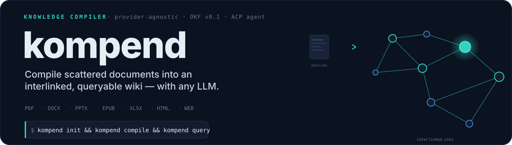
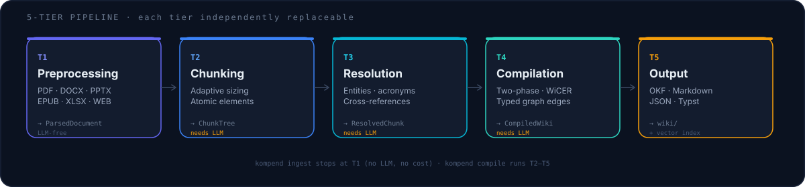

# kompend



kompend refuses to pick a side in the LLM-wiki space. Existing tools either
demand a frontier-model subscription **and** lock you into their stack, or
insist everything run on an underpowered local model while lecturing you
about _privacy_. kompend is provider-agnostic, adapts to whatever LLM you have
— from a local 8B model to a frontier API — and uses structure-preserving
parsing so technical content (tables, equations, figures) survives
extraction intact. [Read the full motivation →](https://jr2804.github.io/kompend/about/motivation/)

> **OKF v0.2 compliant** — produces [Open Knowledge Format](https://github.com/GoogleCloudPlatform/knowledge-catalog/blob/main/okf/SPEC.md) bundles by default.
> **ACP agent** — implements the [Agent Client Protocol](https://agentclientprotocol.com) for credential-free LLM injection via `kompend agent`.
> **PydanticAI-native** — every LLM call routes through typed agents with failover chains; [models.dev](https://models.dev) catalog resolves any provider.

## How it works



kompend runs a 5-tier pipeline — each tier independently replaceable, with a
clear `Base` interface:

| Tier                 | What it does                                                                                                                                                                 | Needs LLM? |
| -------------------- | ---------------------------------------------------------------------------------------------------------------------------------------------------------------------------- | :--------: |
| **T1 Preprocessing** | Parse PDF, DOCX, PPTX, EPUB, XLSX, HTML, URLs into a uniform `ParsedDocument` preserving structure (headings, tables, figures, equations, code).                             |     ❌     |
| **T2 Chunking**      | Split into a `ChunkTree` sized to the model's context window (auto-detected). Atomic elements never split; text runs via recursive paragraph→line→sentence→token boundaries. |     ✅     |
| **T3 Resolution**    | Extract entities, resolve cross-references, acronym/definition consistency. Optional VLM enricher for figure captioning.                                                     |     ✅     |
| **T4 Compilation**   | Build an interlinked `CompiledWiki` graph. Two backends: `TwoPhaseCompiler` (default, extract→generate) and `WiCERCompiler` (iterative compile→evaluate→refine).             |     ✅     |
| **T5 Output**        | Write OKF bundles (default), Markdown, JSON, or Typst. Optionally index for semantic search and synthesize an overview.                                                      |     ❌     |

`kompend ingest` stops at T1 — **no LLM, no cost**. `kompend compile` runs T2–T5.

## Quick start

```bash
uv tool install kompend

# 1. Initialize a project
kompend init ./my-wiki && cd ./my-wiki

# 2. Ingest sources (T1 only — no LLM needed)
kompend ingest                              # everything in sources/
kompend ingest paper.pdf notes.docx *.xlsx  # explicit files
kompend ingest --url https://arxiv.org/pdf/2605.07068v1

# 3. Compile the wiki (T2–T5 — needs an LLM)
kompend compile --set compile.llm.default_model=ollama/qwen3

# 4. Query it
kompend query "How does attention scale with sequence length?"
```

> **Debugging tip:** `kompend parse paper.pdf --elements` inspects one file's
> extracted structure before ingesting the full corpus. If parsing looks
> wrong, fix it first — the pipeline won't recover from bad extraction.

## Commands

| Command                                    | Purpose                                                   |
| ------------------------------------------ | --------------------------------------------------------- |
| `kompend init [DIR]`                          | Scaffold a wiki project (`--bare`, `--force`, `--git`)    |
| `kompend ingest FILES...`                     | Parse sources into `.kompend/cache/` (T0–1, no LLM)          |
| `kompend compile FILES...`                    | Full pipeline → interlinked wiki (T2–5, needs LLM)        |
| `kompend query "..."`                         | Ask a natural-language question against the wiki          |
| `kompend organize`                            | LLM-categorize `sources/` into a hierarchy and move files |
| `kompend parse FILES...`                      | Debug: parse documents and print structure (`--elements`) |
| `kompend doctor`                              | Validate dirs, parsers, LLM/VLM connectivity              |
| `kompend status`                              | Show source/article/word counts and last compile time     |
| `kompend config get/set/list/path`            | Inspect and edit configuration (5-layer precedence)       |
| `kompend lint run`                            | Lint wiki: 8 structural + 4 LLM rules (`--fix`, `--llm`)  |
| `kompend review list/approve/reject`          | Manage the review queue for compiled pages                |
| `kompend capture "..."` / `learn` / `distill` | Capture notes → synthesize into wiki pages                |
| `kompend write "TITLE"`                       | One-shot wiki page from a title + optional sources        |
| `kompend provenance [SLUG]`               | Trace a page to its source files                          |
| `kompend memory add/search/synthesize`        | Manage query memory and context synthesis                 |
| `kompend serve`                               | Start the web UI (`--host`, `--port`, `--open`)           |
| `kompend mcp`                                 | Start the MCP server (stdio, for AI clients)              |
| `kompend agent`                               | Start the ACP agent (editor integration)                  |

Full option reference: `kompend <command> --help`

## Key subsystems

| Subsystem            | Description                                                                                                                                               |
| -------------------- | --------------------------------------------------------------------------------------------------------------------------------------------------------- |
| **RAG / Search**     | `HybridRetriever` fuses FTS + vector + token-overlap + raw sources via reciprocal rank fusion. Embeddings via any pydantic-ai provider (`ollama:`, `openai:`, …). |
| **Memory lifecycle** | Confidence decay, tier promotion (working → episodic → semantic → procedural), supersession detection.                                                    |
| **Review queue**     | Route compiled pages through approve/reject/lock before publishing.                                                                                       |
| **MCP server**       | Stdio server exposing `parse_document`, `compile_wiki`, `wiki_capture`, `wiki_learn` to Claude Code, Cursor, etc.                                         |
| **ACP agent**        | Agent Client Protocol server: editors inject LLM credentials via `providers/set` — no API keys in your config.                                            |
| **Configuration**    | 5-layer precedence: CLI > env (`KOMP_*`) > project (`.kompend/config.toml`, walks up) > global (`~/.config/kompend/`) > defaults.                               |

## LLM configuration

kompend uses `provider/model` strings resolved by `build_model()`:

1. **models.dev catalog** — custom providers with known API URLs (`claudinio/`, `opencode/`, `deepseek/`) construct OpenAI-compatible models.
2. **pydantic-ai native** — standard providers (`ollama/`, `openai/`, `anthropic/`, `google/`) via `infer_model()`.

API keys come from the env var each provider advertises. No `api_key` in config:

```toml
[compile.llm]
default_model = "ollama/qwen3"
fallback_chain = ["openai/gpt-4o"]   # tried when the primary fails
reasoning_effort = "none"             # tame over-thinking local models
```

kompend auto-detects each model's context window and sizes every call to fit.
**Recommended: a model with ≥ 32K context** (16K is the functional floor;
the generation stage reserves 16K output tokens). See the
[LLM configuration guide](https://jr2804.github.io/kompend/guides/llm-config/#context-window-requirements)
for the full breakdown.

See the [LLM configuration guide](https://jr2804.github.io/kompend/guides/llm-config/) for the full reference.

## Documentation

> **[jr2804.github.io/kompend](https://jr2804.github.io/kompend/)** — the complete documentation site: architecture deep-dives, tier references, the WiCER loop, CLI guides, and integrations.

## Development

```bash
git clone <repo-url> && cd kompend
uv sync                    # install deps
uv run kompend --help         # verify CLI
uv run pytest tests/       # run tests
mise test                  # run all quality checks
```

## Installing kompend as a dependency

Install from PyPI:

```bash
uv add kompend
# or
pip install kompend
```

The published package is [`kompend`](https://pypi.org/project/kompend/) (released as a `YYYY.M.N` tag; [`uv tool install kompend`](https://pypi.org/project/kompend/) always gets the newest one). Optional extras for parser backends and LLM providers are declared in the repository's `pyproject.toml` and resolve as `uv add "kompend[<extras>]"` or `pip install "kompend[<extras>]"`.

## License

MIT. See [LICENSE](./LICENSE).

## Acknowledgments

- [Karpathy's compiled LLM-wiki Gist](https://gist.github.com/karpathy/442a6bf555914893e9891c11519de94f) — the core concept
- [Rohit G00's LLM Wiki v2 Gist](https://gist.github.com/rohitg00/2067ab416f7bbe447c1977edaaa681e2) — memory lifecycle, knowledge graph, hybrid search
- [WiCER paper](https://arxiv.org/pdf/2605.07068v1) (Huerta, Zinnia Tech) — iterative compilation loop
- [Docling](https://github.com/docling-project/docling) (IBM) — structure-preserving parsing
- [Chonkie](https://github.com/feyninc/chonkie) — multi-strategy chunking
- [pydantic-ai](https://ai.pydantic.dev) — typed agent framework
- [models.dev](https://models.dev) — provider/model catalog
