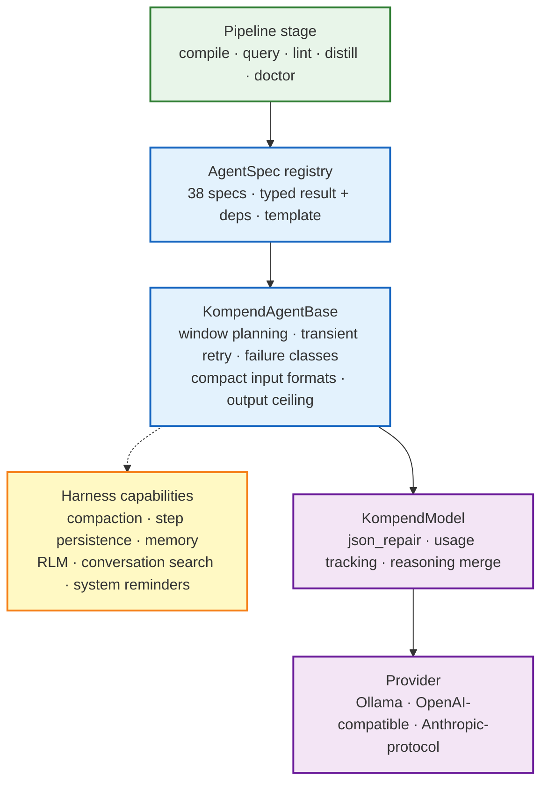
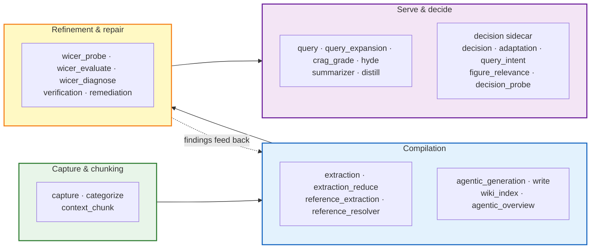
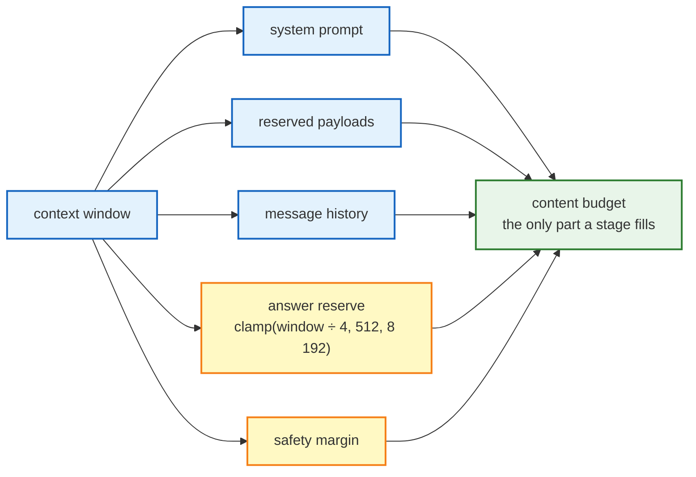
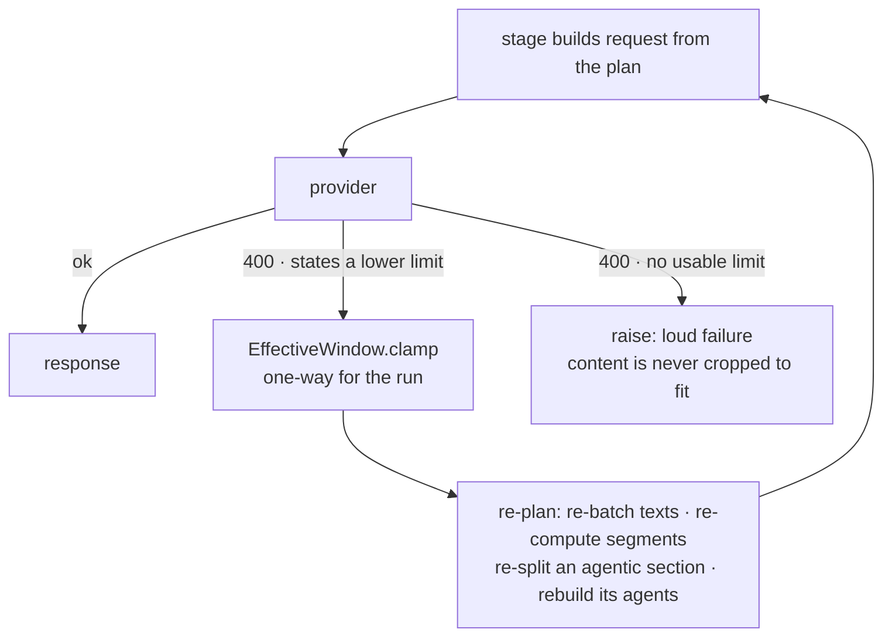
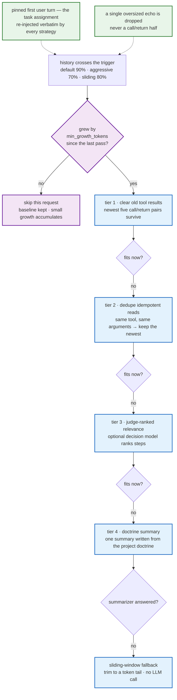
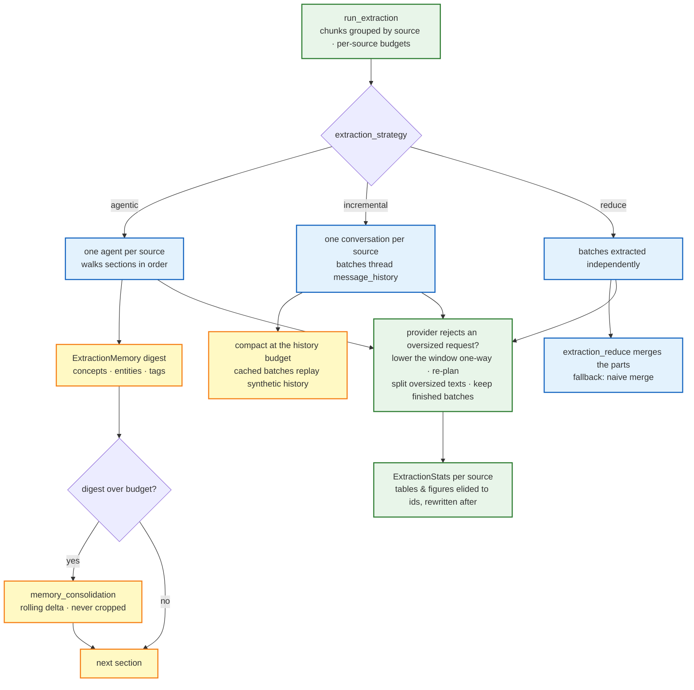

# The Agentic Layer: Tasks, Context & Extraction

Every LLM call kompend makes goes through the agentic layer: a registry of
typed agent specs, one shared execution machine, and a set of extraction
strategies that decide the *shape* of a run. This page explains how the three
fit together — what a "task" is, how a request is sized against the model's
context window, how history is folded when it grows too large, and how the
extraction strategies differ. Configuration depth lives in
[Model Context Adaptation](../guides/model-context.md) and
[LLM Configuration](../guides/llm-config.md); the per-agent reference
(result types, deps, templates) lives in
[Agents & Skills](../reference/pydantic-ai-agents.md).

## One machine, many tasks

kompend does not call provider SDKs. Every interaction is a registered
`AgentSpec` — a typed result model, a deps type, a Jinja template and a model
builder — behind a typed facade class extending
`KompendAgentBase[ResultT, DepsT]`. The specs are the *what*; the base class
is the *how*:

The base class owns the cross-cutting policy so no agent re-implements it:

- **Nothing is ever cropped.** A request that cannot fit the planned budget
  raises `LLMOutputError` naming the components; content is re-planned into
  windows instead of shortened.
- **One timeout, one retry policy.** Transient failures (timeouts, dropped
  connections, retryable status codes) are retried with backoff inside
  `_invoke`; every other failure is classified
  (`empty_answer`, `schema_mismatch`, `context_overflow`, `transient`,
  `other`) and handled by the caller.
- **Compact input formats are a property of the agent.** `compile.llm.data_format`
  selects JSON, TOON or ISON for payloads; the agent carries the resolved
  format and its template self-describes the notation. Model output stays JSON.
- **The output ceiling is derived, not capped.** `max_tokens` is never sent
  wholesale; the answer reserve is planned from the context window, and
  Anthropic-protocol models — whose field is mandatory — get a per-request
  ceiling computed as window − prompt − safety margin, catalog-clamped.

On top of the base class, long-running agents opt into pydantic-ai harness
capabilities: SQLite step persistence (so an interrupted segment resumes from
its transcript), BM25 conversation search, system reminders, an RLM code
REPL, and a notebook memory that summarisation, verification, remediation and
distillation read and write.

## The task inventory

The 38 registered specs map onto the pipeline phases. Single-shot tasks have
a plain spec; tasks that need tools, memory or resumability have an
**agentic twin** that runs as a harness session instead of one request.

| Phase | Tasks | Agentic twins |
|---|---|---|
| Capture & organize | `capture`, `categorize` | — |
| Chunking | `context_chunk` | `agentic_context_chunk` |
| Extraction & references | `extraction`, `extraction_reduce`, `reference_extraction`, `reference_resolver` | — |
| Generation & output | `agentic_generation`, `write`, `wiki_index`, `agentic_overview` | `write` → `agentic_write` |
| Refinement (WiCER) | `wicer_probe`, `wicer_evaluate`, `wicer_diagnose` | — |
| Verification & repair | `verification`, `remediation` | `agentic_verification`, `agentic_remediation` |
| Summarise & distil | `summarizer`, `distill`, `memory_consolidation` | `agentic_summarizer`, `agentic_distill` |
| Query & retrieval | `query`, `query_expansion`, `crag_grade`, `hyde` | `agentic_query` |
| Decision sidecar | `decision`, `adaptation`, `query_intent`, `figure_relevance`, `decision_probe` | — |
| Diagnostics & vision | `doctor`, `lint_rule`, `vlm` | — |

Two details worth knowing when reading the inventory:

- **The extraction strategies below do not need their own specs** — `agentic`
  extraction is a *flow* (`src/kompend/compilation/flows/agentic.py`) that
  drives section agents and a memory-consolidation agent, while `batch`,
  `reduce` and `incremental` reuse the `extraction` / `extraction_reduce`
  specs.
- **The decision sidecar is a separate model by design** — a small, fast
  "system one" model (TypeSafe Jev, Ollama Clef, …) that answers one typed
  question per call: triage a failed generation request, decide whether a
  segment should shrink, route a query's intent, judge whether a figure
  deserves a VLM caption. It is text-only and fail-open: when it is
  unavailable, the deterministic path decides exactly as before. Setup in
  [LLM Configuration](../guides/llm-config.md#decision-model-optional-sidecar).

## How a request is sized

Every request is budgeted by the shared planner
(`kompend.llm.request_budget.RequestBudget`), never by stage-local
arithmetic. A stage declares its context window and its *named reserved
payloads* (system prompt, known titles, the extraction digest …) and reads
its content budget from the plan:

Counts convert between tokens and characters through one shared ratio
(`kompend.core.text.density`, 2.5 chars/token conservative) so the planner,
the compaction triggers and the log figures can never disagree.

When a provider rejects an oversized request *with a stated limit*, the
window is lowered — one-way for the run — and the stage re-plans against the
smaller window:

Extraction re-batches and splits oversized texts into windows
(`split_text_windows` keeps every character), generation halves and re-queues
segments (Loop 1), and a second opinion from the decision sidecar (Loop 2)
can confirm or decline a shrink. A bound on consecutive clamps keeps a
misbehaving provider from looping forever; a repeated identical limit raises.

## Context management: folding history

Multi-turn agents — the WiCER probe/judge loops, agentic summarisation,
generation, incremental extraction — thread one `message_history` across
their units. When that history approaches the window, kompend folds it
instead of failing. The full configuration reference is
[Conversation Compaction](../guides/model-context.md#conversation-compaction);
the machinery looks like this:

The stack runs cheapest-first and stops as soon as the history fits — tiers 1
and 2 cost zero LLM calls. Three invariants matter more than the tiers:

- **The task assignment is pinned.** The first user turn is marked before any
  tier runs and re-injected verbatim; if it alone exceeds the budget the trim
  warns that the request cannot be saved rather than silently cropping the
  task.
- **Nothing re-derivable is lost.** Source text is never carried in history
  alone — agents re-read it through their tools — and load-bearing state
  (the plan, known titles, the extraction digest) lives in agent deps and is
  re-rendered into each prompt.
- **Folds pay for themselves.** `min_growth_tokens` re-arms compaction only
  after real growth, because a fold invalidates the provider's prompt cache
  from the rewrite point on.

Estimation is deliberately pessimistic: the harness anchors on the newest
provider-reported usage and counts only the post-anchor tail from characters,
at 2.5 chars/token (measured worst-case under-count 1.27× on 733 real
request tails). The same callable feeds every strategy, trigger and log
line. A history-threading agent additionally gets the `compact_context` tool
so the model can fold at a natural break instead of waiting for the trigger.

The agentic extraction flow runs its own variant of the same discipline: its
`ExtractionMemory` digest is sized by the shared planner, and when it outgrows
its budget a memory-consolidation agent writes a rolling delta — the digest is
consolidated, never cropped.

## Extraction strategies

`llm.extraction_strategy` picks how a source's chunks become one structured
extraction. The field is an `ExtractionStrategy` enum; `incremental` is the
default.

| Strategy | Coherence | Cost profile | Batch cache | Choose when |
|---|---|---|---|---|
| `reduce` | per-batch, then one merge pass | parallel-friendly; merge adds one call per source | yes, per batch | sources too big for one window; throughput first |
| `incremental` *(default)* | rolling — each batch sees prior batches | sequential per source; compaction keeps the thread alive | yes, with synthetic history for cached batches | the general case |
| `agentic` | highest — a stateful digest guides the whole source | sequential; consolidation calls on long sources | per source, not per batch | long, high-value sources where early sections should shape later extraction |

All three paths share the same machinery: per-source caching whose keys carry
the model (`compile.cache_ignore_model` drops it for a mid-run model switch),
a bounded retry loop that never repeats a pointless request (an empty answer
is resampled, a context overflow is re-planned instead), failure records per
unit — a failed unit is logged and skipped, never silently dropped — and the
progress bar counting the units the flow actually works in (sections for
`agentic`, batches otherwise).

When every batch of a source fails, the run aborts asking for a larger
context window or a smaller `chunk_size_max` — the fix is always more room,
never less content.

## Reading the machinery

| Start here | For |
|---|---|
| `src/kompend/agents/` (package docs in its `AGENTS.md`) | spec registry, base class, context manager |
| `src/kompend/llm/request_budget.py` | the shared planner and the density ratio |
| `src/kompend/compilation/flows/extraction/` | strategy dispatch, batching, overflow re-plans |
| `src/kompend/compilation/flows/agentic.py` | the agentic extraction digest and its consolidation |
| `docs/reference/pydantic-ai-agents.md` | every spec's result type, deps and template |
| `docs/guides/model-context.md` | every knob the machinery reads |
