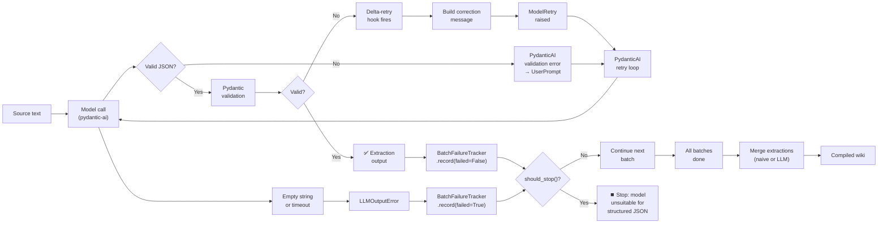

# Decision Log

All architectural, tooling, and design decisions for KNOX. Each entry includes the decision, the context, and the rationale.

## Naming

### Decision: Project name is "KNOX"

**Date:** Jun 5, 2026  
**Context:** Need a pronounceable, memorable name for the compiled LLM-wiki system. Must avoid collision with existing tools ("llm-wiki", "sage-wiki", "llmwiki" all taken).  
**Options considered:**

- KNOX (Knowledge Organizer for eXtended documents) — vault-like, strong
- KITE (Knowledge Ingestion & Transformation Engine) — light, fast
- WIKEN (Wiki Knowledge ENgine) — clear intent
- KARBY (KARpathy Better knowledge sYstem) — playful nod
- WISE (Wiki-Ingestion System for Enhanced documents) — professional

**Decision:** KNOX. Short, pronounceable, implies a secure/organized knowledge vault.
**Consequences:** Slug is `knox`, repo at `codeberg.org/jr2804/knox`.

## Stack

### Decision: Python backend with uv

**Date:** Jun 5, 2026  
**Context:** Need fast iteration, rich ML/NLP ecosystem, easy agent integration. Go (sage-wiki) is fast but lacks the Python ML/NLP ecosystem (docling, pydantic-ai). Rust is too slow for prototyping.  
**Decision:** Python 3.12+, uv for packaging, mise for task running.
**Consequences:** Cannot produce a single static binary. Distribution via PyPI + `uv pip install`.

### Decision: Use copier-uv-plus template

**Date:** Jun 6, 2026  
**Context:** Need project scaffolding with modern Python tooling (ruff, ty, mise tasks, AGENTS.md, skills).  
**Decision:** `codeberg.org/jr2804/copier-uv-plus` v1.3.0.
**Consequences:** Template provides `.config/mise/`, `ruff.toml`, `ty.toml`, `.pre-commit-config.yaml`. Must be properly instantiated via copier (not manual). Initially botched — template had Jinja ext dependencies; fixed by installing `copier-template-extensions`.

### Decision: AGPL-3.0 license

**Date:** Jun 5, 2026  
**Context:** Open-source from day 1, but private until first release. Want copyleft to protect the commons.  
**Decision:** AGPL-3.0. Strong copyleft, viral, protects against proprietary forks.
**Consequences:** Some enterprises may avoid. Acceptable for research/academic tool.

## Architecture

### Decision: 5-tier pipeline with decoupled parsing

**Date:** Jun 5, 2026  
**Context:** Existing tools (sage-wiki, llmwiki) bake weak parsers into the compiler. This causes the "flattening problem".  
**Decision:** Decouple parsing (Tier 1) from compilation (Tier 4). Parsers produce `ParsedDocument` with structured JSON sidecar. Compilers consume structured data, not flat markdown.
**Consequences:** More code, more interfaces. But each tier independently replaceable and testable.

### Decision: Hybrid chunking (custom + Chonkie)

**Date:** Jun 6, 2026  
**Context:** Chonkie operates on text/markdown strings. KNOX's parser produces typed `DocumentElement` objects. Feeding typed objects into Chonkie means serialization → lossy.  
**Decision:** Custom structure-aware chunker for atomic elements (tables/figures/equations never split) + Chonkie for text-heavy sections.
**Consequences:** Two code paths. Must maintain consistency between custom chunker and Chonkie token counting.

### Decision: WiCER iterative compilation loop

**Date:** Jun 6, 2026  
**Context:** WiCER paper (arXiv:2605.07068v1) shows blind compilation over-compresses 2–3× beyond targets. Quality loss is catastrophic, not gradual.  
**Decision:** Implement CEGAR-style loop: compile → evaluate probe Q&A → diagnose failures → refine with pinned facts → repeat.
**Consequences:** Compilation is 2–3× slower than one-shot. But quality recovered to ~80% of full-context baseline. Acceptable tradeoff.

## Parsing

### Decision: parsecraft as the ingestion backend

**Date:** Oct 9, 2026  
**Context:** Benchmark winner is opendataloader-pdf (0.907), but a single engine per corpus cannot serve a born-digital page and a scanned, table-heavy page in the same document — and knox-side adapters for docling, liteparse and pandoc duplicated what parsecraft already does.  
**Decision:** `[ingest] parser` names one backend, default `parsecraft`, which routes each page across its own sub-backends (native, LiteParse, docling, pandoc, OCR). `knox[parsecraft]` carries the sub-backends; `knox[systemone]` adds the judge tier.
**Consequences:** Routing, fallback and OCR escalation are parsecraft's to decide; the knox-side docling/liteparse/pandoc/glm-ocr adapters are deleted. One external dependency pinned to a parsecraft release.

### Decision: Format-native parsing, not PDF-first

**Date:** Jun 6, 2026  
**Context:** "Convert anything to PDF first" simplifies the pipeline but loses native structure from DOCX/XLSX.  
**Decision:** Route by page type rather than flattening to PDF: parsecraft sends each page to a sub-backend that preserves its native structure (PDF text layer or OCR, DOCX styles → headings, XLSX → tables).
**Consequences:** Structure survives from the source format. The split happens per page inside parsecraft, so knox carries no per-format parser modules.

### Decision: Image extraction mode configurable

**Date:** Jun 5, 2026  
**Context:** Extracted images can be embedded as base64 (self-contained) or saved as files (smaller JSON, referenced by path).  
**Decision:** Configurable `image_mode`: `"base64"` (embedded, portable) or `"file"` (external, smaller). Default `"file"`.
**Consequences:** Base64 produces large JSON sidecars. File mode requires path management.

## Chunking

### Decision: Structure-aware chunking: atomic elements never split

**Date:** Jun 6, 2026  
**Context:** Splitting a table or figure across chunks destroys queryability. "What was the performance requirement in Section 3.2?" requires the full table.  
**Decision:** Tables, figures, equations, code blocks are atomic — never split. Only text sections get chunked.
**Consequences:** Some chunks may exceed token budget if a table is very large. Use `TableChunker` for row-wise splitting in that case.

### Decision: Model token limit auto-detection

**Date:** Jun 6, 2026  
**Context:** Different models have different context windows (4K, 8K, 32K, 128K, 1M). Manual configuration is error-prone.  
**Decision:** Auto-detect the context window — provider override, then Ollama's own report, then the models.dev catalog — instead of a hand-set value. Hold back a safety margin for system prompts (8% of the window, minimum 512 tokens).
**Consequences:** Depends on the provider or catalog reporting the model. An unknown model falls back to the configured `fallback_max_input`/`fallback_max_output` (32K/4K by default); with neither set, discovery raises instead of guessing.

## Resolution

### Decision: One-shot default, multi-turn opt-in

**Date:** Jun 5, 2026  
**Context:** Multi-turn resolution (abbreviation expansion, cross-reference validation) is powerful but slow (seconds per document).  
**Decision:** Default: one-shot ingestion (fast). Per-document opt-in: `--resolve` flag enables multi-turn.
**Consequences:** Most documents compile fast. Complex papers get extra attention on demand.

### Decision: VLM for figure captioning, not native parser

**Date:** Jun 6, 2026  
**Context:** Docling has vision fallback for figures, but caption quality is poor. Standalone VLM (GPT-4V, Claude 3, Gemini) produces better captions.  
**Decision:** Use parser for figure extraction (PNG + bbox + surrounding text). Send to VLM for captioning during resolution tier.
**Consequences:** Requires VLM API or local model. Adds latency. But captions are queryable.

## Compilation

### Decision: pydantic-ai for provider abstraction

**Date:** Jun 5, 2026  
**Context:** Need to support Ollama (local), OpenRouter, DeepSeek, Anthropic, OpenAI without hard-coding each.  
**Decision:** pydantic-ai — one `provider/model` string per backend, translated to native provider models (`knox.llm.models.build_model`). Custom OpenAI-compatible endpoints are declared under `[providers.<id>]`.
**Consequences:** One dependency in the LLM path; provider-specific code is confined to model construction. A custom endpoint needs a `[providers.<id>]` entry rather than a model-string convention alone.

### Decision: Local-first model strategy

**Date:** Jun 6, 2026  
**Context:** Running everything via API is expensive and slow. Local models on BunStation (Ollama) are fast and free.  
**Decision:** Default to local Ollama models for pre-processing (chunking heuristics) and WiCER evaluation (LLM-as-judge). Fallback to remote for compilation synthesis if quality insufficient.
**Consequences:** Requires Ollama running. But dramatically reduces cost.

## Output

### Decision: No custom GUI. Use Open-WebUI

**Date:** Jun 6, 2026  
**Context:** Building a web UI is time-consuming and not core value. Existing tools (Open-WebUI) already solve this.  
**Decision:** KNOX exposes CLI + MCP + Python SDK. Open-WebUI connects via API/MCP.
**Consequences:** Users who want a web UI need separate Open-WebUI install. But zero UI dev effort.

### Decision: Markdown + JSON dual output

**Date:** Jun 6, 2026  
**Context:** Markdown for humans (Obsidian), JSON for machines (graph queries, MCP tools).  
**Decision:** Always produce both. Markdown is primary human-readable. JSON is primary machine-readable.
**Consequences:** Double disk usage. Acceptable.

## Integration

### Decision: MCP server = thin CLI wrapper

**Date:** Jun 5, 2026  
**Context:** Some tools duplicate business logic between CLI and MCP. This causes drift.  
**Decision:** MCP server calls CLI commands. Zero logic in MCP layer.
**Consequences:** MCP is slower (fork/exec overhead). But no drift.

### Decision: Hermes skill wraps CLI, not MCP

**Date:** Jun 5, 2026  
**Context:** Hermes can call either MCP tools or CLI commands. Which is better?  
**Decision:** Hermes skill calls CLI (`knox compile`, `knox parse`). Simpler, no MCP server required.
**Consequences:** Hermes must have knox installed. But no separate MCP process to manage.

## Testing

### Decision: Use listening-effort corpus for local dev

**Date:** Jun 5, 2026  
**Context:** Need real-world scientific papers for testing. ETSI standards, AES papers as benchmark.  
**Decision:** Use `Worky/research/listening-effort/` corpus. Never commit to upstream repo.
**Consequences:** Local testing only. CI cannot replicate without corpus.

## References

- Worky's research: `Worky/research/llm-wiki/` (Obsidian vault)
- WiCER paper: <https://arxiv.org/pdf/2605.07068v1>
- Karpathy's Gist: <https://gist.github.com/karpathy/442a6bf555914893e9891c11519de94f>

## Chunking (2026-06)

### Decision: Replace flat chunk list with hierarchical chunk tree

**Date:** Jun 22, 2026  
**Context:** The original HybridChunker produced a flat `list[Chunk]` — heading hierarchy was stored as a string (`heading_context = "Chapter 1 / Section 1.2"`), not navigable. Tables, equations, and figures were stringified to text during chunking, losing their structure. Retrieval was context-window-blind (fixed top_k, no adaptive depth). Resolution processed each chunk independently with no cross-section reasoning.

**Alternatives considered:**

1. **Keep flat chunks, add RAG-style retrieval improvements** — rejected: doesn't solve structured content loss or cross-reference reasoning.
2. **RAPTOR-style recursive summarization only** — rejected: summarization is lossy for tables/equations. Only suitable for prose; structured content needs structured extraction.
3. **Keep flat chunks, add separate structured store** — rejected: separates content from its document context, complicates resolution and compilation.

**Decision:** Replace HybridChunker with HierarchicalChunker producing `ChunkTree` — a tree of `ChunkNode` objects with parent/child relationships, heading paths, and typed structured data (StructuredTable, StructuredEquation, StructuredFigure). No backward compatibility — the old flat path is deleted entirely.

**Consequences:**

- ChunkTree replaces `list[Chunk]` throughout the pipeline (no backward compat).
- Structured data (tables/equations/figures) preserved as typed records, not stringified.
- Entity registry enables programmatic cross-reference checking at data level.
- Adaptive retrieval can zoom in/out based on available context budget.
- Same analytical pattern (fractal) applies at document and wiki levels.
- 5-phase implementation: data structures (Phase 0) → chunker (Phase 1) → extraction + summaries (Phase 2) → entity registry + xref (Phase 3) → adaptive retrieval (Phase 4) → multi-resolution compilation (Phase 5).

**Related:** knox-evmg, knox-ctwe, knox-hhf5, knox-rves, knox-96qo, knox-ne47

## Extraction Retry & Failure Detection (2026-03)

### Decision: Layered retry with circuit breaker and model pre-check

**Date:** Mar 19, 2026  
**Context:** Small (<3B param) or unsuitable models fail extraction by returning empty strings or structurally invalid JSON. PydanticAI's built-in retry loops exhaust attempts (default 4 retries = 5 attempts) without producing valid output, leading to confusing "Exceeded maximum output retries" errors. The circuit breaker (BatchFailureTracker) was designed to stop early but its defaults (50% failure, minimum 5 batches) masked the problem for small source sets.

**Failure cascade (captured during investigation of gemma4:e2b on 3 PDFs):**

**Key parameters added/standardized (all configurable in `[compile.llm]`):**

| Parameter                       | Default | Purpose                                                   |
| ------------------------------- | ------- | --------------------------------------------------------- |
| `output_retries`                | 2       | PydanticAI retry count (N attempts = N+1 total)           |
| `output_retries_enabled`        | true    | Master switch for all retries                             |
| `delta_retry_enabled`           | true    | Enable delta-retry (fix partial output vs regenerate)     |
| `batch_failure_threshold_ratio` | 0.5     | Stop when >50% batches fail                               |
| `batch_failure_threshold_min`   | 5       | Minimum batches before stopping (lower for small corpora) |
| `batch_retry_attempts`          | 3       | Extra per-batch retries before counting as failed         |
| `slug_max_length`               | 80      | Max concept-page slug length                              |
| `min_segment_tokens`            | 512     | Min tokens per generation segment                         |
| `default_chars_per_token`       | 3.85    | Token budget estimation heuristic                         |

**Rationale:** Rather than increasing retries (which makes the problem worse for unsuitable models), we detect unsuitability early, fail fast, and expose every threshold to user configuration. The doctor command now includes a structured-output pre-check that probes for model capability before compilation begins.

**Consequences:**

- User must configure thresholds for their corpus size and model
- Doctor pre-check catches "empty string" failure before compile
- Delta-retry hint directs users to disable for small models
- POLICIES.md now requires all magic numbers to be config fields

**Related:** Investigation session (2026-03-19, gemma4:e2b on listening-effort corpus)

## Agentic vs Single-Shot (2026-09)

### Decision: Which LLM actions stay single-shot by design

**Date:** Sep 24, 2026

**Context:** The "migrate all LLM-based actions to agentic multi-turn workflows"
epic (`knox-0iv2`) proposed converting every LLM call into a tool-using agent.
A read-only code audit (`.agents/history/2026-09-24-knox-0iv2-audit.md`) found
that several actions are single-shot by design, that proposed agentic variants
were built but never wired (then removed, or reachable only from tests), and
that two areas are satisfied by a different design. This entry records the
decisions so they are not re-opened as "missing agentic conversions".

**Decision:** The actions below are deliberately single-shot. A proposal to
convert one must argue against the stated rationale, not merely assert that a
tool-using agent is more capable.

| Action | Agent | Why single-shot by design |
| --- | --- | --- |
| Reference extraction | `ReferenceExtractionAgent` | Bounded extraction over one document's reference list; the input is already in context, so no tools are needed. |
| Reference resolution | `ReferenceResolverAgent` | Resolves a fixed batch of extracted references; no on-demand fetching and no cross-item state. |
| Source categorization | `CategorizeAgent` | One call returns the whole category tree from a fixed source list; iterating with tools adds turns without adding information. |
| Capture | `CaptureAgent` | One call turns a block of conversation text into structured items; the block *is* the context. |
| Lint rules | `LintRuleAgent` | Each rule is one focused judgement over a rendered page/prompt; rules are independent and need no shared session. |
| WiCER probe / evaluate / diagnose | `WicerProbeAgent` / `WicerEvaluateAgent` / `WicerDiagnoseAgent` | The WiCER CEGAR loop *is* the multi-turn orchestrator; each sub-call is a bounded single-turn task by design. |
| VLM captioning | `VlmAgent` | Vision calls dominate cost and latency; multi-turn captioning adds no cross-item state. |
| Doctor ping | `DoctorAgent` | Connectivity probe returning a short status string; no tools, no memory. |
| Query expansion / CRAG grading / HyDE | `QueryExpansionAgent` / `CragGradeAgent` / `HydeAgent` | One-shot transforms inside an already multi-stage retrieval pipeline; each runs independently per query. |

**Satisfied by a different design (not missing):**

- **Extraction.** The `AGENTIC` extraction strategy
  (`compile.llm.extraction_strategy`) uses the ordinary `ExtractionAgent` with
  a compaction-managed memory digest (`compilation/flows/agentic.py`), not a
  distinct tool agent. Cross-chunk context is carried in the digest rather
  than by retrieving chunks on demand.
- **Capture.** Single-shot `CaptureAgent` by design (see the table); the
  planned agentic capture was never built.

The legacy template `GenerationAgent` and its `generate_all_pages()` loop were
removed in `knox-0iv2.12`. An `Agentic*` class file existing on disk is **not**
evidence that an agentic path is wired — wiring status is tracked in
`knox-0iv2`.

**Consequences:**

- New proposals to make a listed action agentic must reference this decision
  and the tracker, and show a concrete failure of the single-shot form.
- Agentic remains the chosen design where work genuinely benefits from
  on-demand fetching or cross-item synthesis in one session (remediation,
  verification, write, distill, generation, overview).

**Related:** `knox-0iv2`, `knox-0iv2.7`, `knox-0iv2.8`, `knox-0iv2.9`, `knox-0iv2.11`, `knox-0iv2.13`, `knox-0iv2.14`
