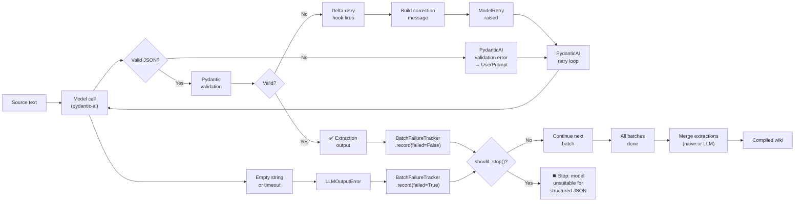

# Decision Log

All architectural, tooling, and design decisions for kompend. Each entry includes the decision, the context, and the rationale.

## Naming

### Decision: Project name is "kompend"

**Date:** Jun 5, 2026  
**Context:** Need a pronounceable, memorable name for the compiled LLM-wiki system. Must avoid collision with existing tools ("llm-wiki", "sage-wiki", "llmwiki" all taken).  
**Options considered:**

- KOMPEND (Knowledge-Oriented Markdown Processing and ENtity Distillation) — concise, mnemonic
- KITE (Knowledge Ingestion & Transformation Engine) — light, fast
- WIKEN (Wiki Knowledge ENgine) — clear intent
- KARBY (KARpathy Better knowledge sYstem) — playful nod
- WISE (Wiki-Ingestion System for Enhanced documents) — professional

**Decision:** kompend. Short, pronounceable, implies a secure/organized knowledge vault.
**Consequences:** Slug is `kompend`, repo at `github.com/jr2804/kompend`.

## Stack

### Decision: Python backend with uv

**Date:** Jun 5, 2026  
**Context:** Need fast iteration, rich ML/NLP ecosystem, easy agent integration. Go (sage-wiki) is fast but lacks the Python ML/NLP ecosystem (docling, pydantic-ai). Rust is too slow for prototyping.  
**Decision:** Python 3.12+, uv for packaging, mise for task running.
**Consequences:** Cannot produce a single static binary. Distribution via PyPI, installed with `uv tool install` or `uv add`.

### Decision: Use copier-uv-plus template

**Date:** Jun 6, 2026  
**Context:** Need project scaffolding with modern Python tooling (ruff, ty, mise tasks, AGENTS.md, skills).  
**Decision:** `codeberg.org/jr2804/copier-uv-plus` v1.3.0.
**Consequences:** Template provides `.config/mise/`, `ruff.toml`, `ty.toml`, `.pre-commit-config.yaml`. Must be properly instantiated via copier (not manual). Initially botched — template had Jinja ext dependencies; fixed by installing `copier-template-extensions`.

### Decision: AGPL-3.0 license

**Date:** Jun 5, 2026  
**Context:** Open-source from day 1, but private until first release. Want copyleft to protect the commons.  
**Decision:** AGPL-3.0. Strong copyleft, viral, protects against proprietary forks.
**Consequences:** Some enterprises may avoid. Acceptable for research/academic tool.

## Architecture

### Decision: 5-tier pipeline with decoupled parsing

**Date:** Jun 5, 2026  
**Context:** Existing tools (sage-wiki, llmwiki) bake weak parsers into the compiler. This causes the "flattening problem".  
**Decision:** Decouple parsing (Tier 1) from compilation (Tier 4). Parsers produce `ParsedDocument` with structured JSON sidecar. Compilers consume structured data, not flat markdown.
**Consequences:** More code, more interfaces. But each tier independently replaceable and testable.

### Decision: Hybrid chunking (custom + Chonkie)

**Date:** Jun 6, 2026  
**Context:** Chonkie operates on text/markdown strings. kompend's parser produces typed `DocumentElement` objects. Feeding typed objects into Chonkie means serialization → lossy.  
**Decision:** Custom structure-aware chunker for atomic elements (tables/figures/equations never split) + Chonkie for text-heavy sections.
**Consequences:** Two code paths. Must maintain consistency between custom chunker and Chonkie token counting.

### Decision: WiCER iterative compilation loop

**Date:** Jun 6, 2026  
**Context:** WiCER paper (arXiv:2605.07068v1) shows blind compilation over-compresses 2–3× beyond targets. Quality loss is catastrophic, not gradual.  
**Decision:** Implement CEGAR-style loop: compile → evaluate probe Q&A → diagnose failures → refine with pinned facts → repeat.
**Consequences:** Compilation is 2–3× slower than one-shot. But quality recovered to ~80% of full-context baseline. Acceptable tradeoff.

## Parsing

### Decision: parsecraft as the ingestion backend

**Date:** Oct 9, 2026  
**Context:** Benchmark winner is opendataloader-pdf (0.907), but a single engine per corpus cannot serve a born-digital page and a scanned, table-heavy page in the same document — and kompend-side adapters for docling, liteparse and pandoc duplicated what parsecraft already does.  
**Decision:** parsecraft is the only parser path — the `[ingest] parser` selector was retired. `[ingest]` keeps only what is kompend's own: how much of the host a heavy parse may use (`parsecraft_docling_threads`, `parse_min_free_commit_mb`, `max_concurrent_heavy_parses`) and where figures land. Routing itself — `preference`, `allow_ocr`, `engines`, `preferred_backend`, `only_backend`, `backend_options`, and the judge (`[judge] model`) — is parsecraft's configuration and is read from parsecraft's own files (`~/.config/parsecraft/config.toml`, `<wiki>/.kompend/parsecraft.toml`, `./parsecraft.toml`, `PARSECRAFT_CONFIG_*`); the six routing keys and the judge pair kompend used to mirror were retired into `REMOVED_KEYS`. The adapter hands every source to `pipeline.execute()`. parsecraft is a core dependency, so the sub-backends and the judge tier's SDK (no extra since parsecraft 2026.10.5) arrive with it; `kompend[mineru]`, `kompend[ocr]` and the licence-gated `kompend[pymupdf]` / `kompend[pdf-full]` stay opt-in.
**Consequences:** Routing, fallback and OCR escalation are parsecraft's to decide; the kompend-side docling/liteparse/pandoc/glm-ocr/web/marker/mineru adapters are deleted — mineru returns as the `kompend[mineru]` sub-backend extra, marker is parsecraft's bring-your-own. One external dependency with a minimum parsecraft release.

### Decision: Format-native parsing, not PDF-first

**Date:** Jun 6, 2026  
**Context:** "Convert anything to PDF first" simplifies the pipeline but loses native structure from DOCX/XLSX.  
**Decision:** Route by page type rather than flattening to PDF: parsecraft sends each page to a sub-backend that preserves its native structure (PDF text layer or OCR, DOCX styles → headings, XLSX → tables).
**Consequences:** Structure survives from the source format. The split happens per page inside parsecraft, so kompend carries no per-format parser modules.

### Decision: Image extraction mode configurable

**Date:** Jun 5, 2026  
**Context:** Extracted images can be embedded as base64 (self-contained) or saved as files (smaller JSON, referenced by path).  
**Decision:** Configurable `image_mode`: `"base64"` (embedded, portable) or `"file"` (external, smaller). Default `"file"`.
**Consequences:** Base64 produces large JSON sidecars. File mode requires path management.

### Decision: Parse memory budget follows the routing plan

**Date:** Nov 9, 2026  
**Context:** The heavy-parse guard classified by file suffix, so every PDF was held to docling's budget even when liteparse read it. On a host with ~5 GB free commit charge and the then-default 10240 MB, a liteparse-only vault skipped all 33 of its PDFs with no setting that could have let them through. The same message also lost its config keys (Rich markup ate `[ingest]`), and the budget itself came from a docling-rs 2.55.4 measurement (8.0 GB) that 2.65.1 does not support (1830 MB at four threads).  
**Decision:** The headroom check moved into the parsecraft adapter, the only layer that holds a routing plan: `ParserOptions.parse_min_free_commit_mb` reaches it as bytes and `_ensure_headroom` budgets the *chosen* pass — a native page lists docling as a fallback candidate even when liteparse wins, so budgeting candidates would refuse files for an engine they never run. The suffix-based `HeavyParseGuard` keeps the concurrency cap only. Default lowered to 4096 MB; the refusal names the planned engine, and the terminal handler now runs with `markup=False` so `[ingest]` reaches the user as the config table it is instead of vanishing as a Rich style tag.  
**Consequences:** A PDF routed to liteparse is never refused for docling's budget; a fallback pass can still load an engine after the chosen pass produced nothing, which the concurrency cap serializes and the per-file failure path contains. `kompend parse` and the MCP parse tools are guarded too, because the check lives in the parser instead of the pipeline stage.

### Decision: The parse memory budget follows the engine version

**Date:** Nov 11, 2026  
**Context:** The 1830 MB figure behind the headroom budget came from docling-rs 2.65.1; the host now runs 2.80.0. Re-measured on Windows with the same 8-page PDF and one 113-page PDF: 2921–3042 MB at four threads, 3851 MB at the engine's own thread count, 2577 MB at one thread, 3697 MB for the 113-page document. The peak grows with the document, so "one pass costs the same whatever the length" was wrong.  
**Decision:** `MEASURED_ENGINE_COMMIT_MB` holds the worst measurement (3700 MB), not the average, and `ingest.parse_min_free_commit_mb` defaults to 5120 MB. A guard that under-estimates lets the host die mid-parse; a budget taken from a measurement that no longer exists skips every heavy source.  
**Consequences:** The threshold rises by a gigabyte, so a host with 4–5 GB free commit charge now refuses a docling pass it used to attempt. Measure the peak before moving the default again, and never measure on a host that cannot spare the memory.

### Decision: A blank answer is resampled once, and the window is not a content budget

**Date:** Nov 9, 2026  
**Context:** A 4-bit local model skipped whole sources with `empty_answer after 1 request(s)`. The Ollama server log showed the request was complete (`n_tokens = 43118, truncated = 0`, `n_ctx = 65536`) and the model returned a single EOS token (`eval time = 0.00 ms / 1 tokens`). Six identical probes produced five blanks and one clean answer, so a blank is sampling noise, not a prompt the model cannot satisfy — while a 40K-token prompt makes it far more likely. Raising `compile.llm.context_window` from 32768 to 64000 made every request heavier instead of better, because the extraction budget grew from 21691 to 50424 tokens of source per request.  
**Decision:** `KompendModel` resamples a blank structured-output response once (`_EMPTY_ANSWER_RESAMPLES`) before raising `EmptyAnswerError`, and the retry budget stays unspent because its feedback cannot change a blank answer. `compile.llm.content_window_tokens` sets how much content one request carries, independent of the window; discovery stamps it on `ContextWindow.content_window_tokens`, so `RequestBudget` sizes every payload by it.  
**Consequences:** A stage whose payload exceeds that window splits it — extraction into more batches, generation into more segments, summarization and WiCER probes into more windows — so the cost of a smaller value is more requests, never less content. The value is unset by default (the window decides), so nothing changes for models that handle long prompts well; a local model gets a window that reflects what it can actually answer from.

### Decision: The generation agent searches the run's sources instead of being handed them

**Date:** Nov 9, 2026  
**Context:** Generation runs per segment: the agent sees its own segment content and the concepts assigned to it, and had no way to reach a source outside that segment. A concept that is central to one source but only mentioned there produced a thin page, and the agent could not tell whether the corpus held more. Handing every source to every segment is impossible (the corpus does not fit one window) and a pre-built embedding index over sources does not exist — the vector store indexes compiled wiki pages, and it is built in `post_compile`, after generation.  
**Decision:** `compilation/source_search.SourceIndex` indexes the run's segments (BM25 over the tokens of each source) and the generation toolset gains `search_sources(query, k)` plus `read_source_window(stem, offset)`. When `[embedding] model` is configured, the best lexical candidates are re-scored by cosine against their matched snippet, cached per string — the same two-tier split `_CoverageCredit` uses for page titles.  
**Consequences:** The agent's reach is the whole run without paying for the corpus up front: a hit is a source, an offset and a 400-character preview, and reading costs one window per call (`SOURCE_WINDOW_CHARS`, with the next offset named) — the source is paged, never shortened. A dead embedding provider degrades to the lexical ranking instead of failing the segment. Extraction stays single-pass over its own source: the same tool there would need an agentic extraction pass, which the single-shot decision has not been reopened for.

## Splitting

### Decision: A source is split before it is chunked, and a split fails closed

**Date:** Nov 10, 2026  
**Context:** One source file can hold several documents — a PDF that bundles a dozen standards, a deck that carries an appendix. kompend parsed one document per source file and chunked that document as a whole, so a wiki page ended up covering unrelated documents and every citation pointed at the bundle. Cutting a source apart is only safe when the cut is exact: every element lands in exactly one child, the parent stays intact, and a judge that cannot decide leaves the source alone.  
**Decision:** Splitting is a parse-stage seam (`src/kompend/preprocessing/splitting/`), between parsing and chunking. A `SplitJudge` returns a `SplitPlan` of page ranges, and the plan is validated before anything is cut: an empty, inverted, out-of-range, gapped, overlapped or too-short plan is rejected, never repaired. The partition is a pure read — children own copies of the parent's elements (`dataclasses.replace` with deep-copied metadata) and the parent keeps its own. Every decline fails CLOSED: a failed judge, a document without page structure, and an invalid plan all leave the source whole and record why (a degraded judge, no boundary, too few pages, unpaged content, an oversized page, an invalid plan). Children are virtual sources named `<parent>#p005-009` — the range sits before the suffix so `stem` and `safe_stem` keep it — and each carries its parent (`_split_parent_stem`, `_split_parent_source`), its pages, its category, its decider and the digest of the rules it was cut by. Splitting is off by default: without a splitter the stage writes no ledger row and returns the single tree unchanged.  
**Consequences:** A source can now yield several documents, each with its own chunk tree, cache entry and ledger row, and the child resolves back to its parent through `_split_parent_stem`. "Every page exactly once" is necessary but not sufficient: a partition that mutates elements in place satisfies that invariant while the parent ends up citing pages it no longer owns, so the contract is "children own copies, the parent keeps its own" and it is asserted at the object level. A split is never silent — it is a ledger row — because a run that quietly multiplies its documents changes what the wiki claims to cover.

## Chunking

### Decision: Structure-aware chunking: atomic elements never split

**Date:** Jun 6, 2026  
**Context:** Splitting a table or figure across chunks destroys queryability. "What was the performance requirement in Section 3.2?" requires the full table.  
**Decision:** Tables, figures, equations, code blocks are atomic — never split. Only text sections get chunked.
**Consequences:** Some chunks may exceed token budget if a table is very large. Use `TableChunker` for row-wise splitting in that case.

### Decision: Model token limit auto-detection

**Date:** Jun 6, 2026  
**Context:** Different models have different context windows (4K, 8K, 32K, 128K, 1M). Manual configuration is error-prone.  
**Decision:** Auto-detect the context window — provider override, then Ollama's own report, then the models.dev catalog — instead of a hand-set value. Hold back a safety margin for system prompts (8% of the window, minimum 512 tokens).
**Consequences:** Depends on the provider or catalog reporting the model. An unknown model falls back to the configured `fallback_max_input`/`fallback_max_output` (32K/4K by default); with neither set, discovery raises instead of guessing.

## Resolution

### Decision: One-shot default, multi-turn opt-in

**Date:** Jun 5, 2026  
**Context:** Multi-turn resolution (abbreviation expansion, cross-reference validation) is powerful but slow (seconds per document).  
**Decision:** Default: one-shot ingestion (fast). Per-document opt-in: `--resolve` flag enables multi-turn.
**Consequences:** Most documents compile fast. Complex papers get extra attention on demand.

### Decision: VLM for figure captioning, not native parser

**Date:** Jun 6, 2026  
**Context:** Docling has vision fallback for figures, but caption quality is poor. Standalone VLM (GPT-4V, Claude 3, Gemini) produces better captions.  
**Decision:** Use parser for figure extraction (PNG + bbox + surrounding text). Send to VLM for captioning during resolution tier.
**Consequences:** Requires VLM API or local model. Adds latency. But captions are queryable.

## Compilation

### Decision: pydantic-ai for provider abstraction

**Date:** Jun 5, 2026  
**Context:** Need to support Ollama (local), OpenRouter, DeepSeek, Anthropic, OpenAI without hard-coding each.  
**Decision:** pydantic-ai — one `provider/model` string per backend, translated to native provider models (`kompend.llm.models.build_model`). Custom OpenAI-compatible endpoints are declared under `[providers.<id>]`.
**Consequences:** One dependency in the LLM path; provider-specific code is confined to model construction. A custom endpoint needs a `[providers.<id>]` entry rather than a model-string convention alone.

### Decision: Local-first model strategy

**Date:** Jun 6, 2026  
**Context:** Running everything via API is expensive and slow. Local models on BunStation (Ollama) are fast and free.  
**Decision:** Default to local Ollama models for pre-processing (chunking heuristics) and WiCER evaluation (LLM-as-judge). Fallback to remote for compilation synthesis if quality insufficient.
**Consequences:** Requires Ollama running. But dramatically reduces cost.

### Decision: The source-search judge ranks candidates, it does not filter them

**Date:** Nov 10, 2026  
**Context:** The generation agent searches the run's sources, and the lexical tier ranks them. A lexical rank cannot tell a document that answers the query from one that merely shares its vocabulary: on the measured corpus, the documents a human judge accepted were often ranked 11th to 20th by BM25, and one query whose BM25 top-5 contained no acceptable document at all had three acceptable documents in that tail. The obvious fix — ask a model which candidates are relevant — shipped broken: the decision-model grammar refuses a list of verdict objects ("a list must be of two or more string options"), so every request failed and the tier silently degraded to plain BM25. The unit test passed because it stubbed the judge and never asked the grammar.  
**Decision:** One candidate per request, one typed boolean per answer (`CandidateVerdict`), judged concurrently (a thread pool of eight, one agent per worker thread because the agent base keeps per-run state). The decision grammar cannot express a list of verdicts, so batching is out; what replaces it is rank fusion: the judged candidates that came back relevant are placed first, the rest keep their BM25 order behind them, and an unjudged candidate keeps its BM25 rank. Nothing is filtered out of the result set, and no probability is compared against a threshold — the probability scale moves with the request shape while the ordering holds, so the order is what is fused. A verdict is per candidate: a failure judges that candidate unjudged rather than failing the search, and only a total failure falls through to the semantic tier, with the cause logged. Without a configured decision model no agent is built, no pool is created, and no request is made.  
**Consequences:** The tier costs one request per candidate (~600 input tokens each, no output tokens) against the twenty best lexical candidates, and it is only as good as the prompt: the shipped strict instruction accepts markedly less than a loose one on the same candidates, so the judge is conservative by construction and the fusion leaves the order untouched when nothing discriminates — an unchanged order is a verdict outcome, not a fallback. The first request in a fresh process pays the provider's cold start (tens of seconds for a cloud-hosted model), which is a provider property rather than a kompend one and is reported rather than hidden. A schema the decision grammar refuses is now a doctor finding instead of a silent degradation.

## Context management

### Decision: Compaction trims on tokens, pins the task, and logs every trim

**Date:** Nov 10, 2026  
**Context:** The agentic path keeps a compaction stack in front of the model, and the presets choose how much history survives. The `sliding` preset built the harness' message-count trigger and nothing else, so it fired on the number of messages (a hundred) and not on the size of the request. A measured run reached 381 % of the model window — 244 140 of 64 000 tokens — and the provider refused it (`request (90154 tokens) exceeds the available context size (65536)`); twelve runs reported zero compactions and zero trims while the history was overrunning. The trims that did happen were silent, so a run that was quietly losing its history looked identical to one that was not.  
**Decision:** Every preset trims on tokens. The `sliding` preset gets a token trigger (a fraction of the request's window, resolved per request from the model, with the message cap kept as a coarser second bound) instead of the message count alone, pins the first user turn so the task statement cannot be trimmed away, keeps a token-bounded tail, and logs each trim with the messages dropped and the estimated tokens before and after. The other presets keep their existing tiers and thresholds — they are byte-identical — and the tier chain is gated on growth, so an unchanged history is not trimmed again.  
**Consequences:** The estimator the harness uses is a characters-per-token heuristic that under-counts dense content, so the sliding threshold sits below the point where an estimate is trusted rather than at it; a trim that reclaims nothing is reported as such rather than passed off as a successful trim. Trimming is lossy by construction and the pin is what keeps the loss bounded: the task survives, the middle of the history does not.

### Decision: One chars-per-token heuristic sizes every request

**Date:** Nov 11, 2026  
**Context:** A request is sized in characters and paid for in tokens, so every stage that plans content needs one ratio. Two were in play: the compilation planner sized a segment with the nominal corpus median (3.85 chars per token) while the request-fit guard counted the same segment with the pessimistic density floor (2.5). A segment planned at 3.85 therefore arrived roughly 54 % over the window — the p863 wiki compile (run 2fe130fb, 2026-11-11) died on the provider's answer "prompt too long; exceeded max context length by 2853 tokens" after minutes of upstream work, and the guard's refusal came too late to save the run.  
**Decision:** One heuristic, owned by `kompend.core.text.density` (`CONSERVATIVE_CHARS_PER_TOKEN`, `conservative_tokens`). The planner, the request-fit guard, the extraction/reference/WiCER budgets and the compaction estimator all count with it, and `compile.llm.default_chars_per_token` (now defaulting to the same 2.5) is the single knob. The floor was measured on 733 request tails of the p863 corpus (p01 2.65, median 3.86 chars per token); at the harness's 4 the estimate under-counts 560 of those tails, worst by 2.02x, while at 2.5 it covers 726 of 733.  
**Consequences:** A planned request cannot arrive over the window, and the cost of the margin is a smaller batch — a segment holds about 35 % fewer characters, so the work splits across more requests and no content is cropped. The margin also covers the fixed overhead of an agentic turn (system prompt, tool framing, titles window), so a window too small to host that overhead beside a minimum segment is refused in the planner with a named breakdown instead of sending a request that cannot fit — in practice the agentic tier needs a window of roughly 16K tokens. A vault that raises the ratio opts out of the guarantee and can meet the provider's 400 again.

## Output

### Decision: Markdown emission escapes prose pipes (generation contract)

**Date:** Oct 18, 2026  
**Context:** A kompend-distilled page containing math absolute-value notation (`|delay[i] - delay[i-2]|`) as unescaped pipes in list-item paragraph continuations sent docling's markdown backend into an infinite CPU spin (>1 h ingest hang; upstream issue docling#5108 — `Table.match` probing per paragraph line never terminates). The file was kompend's own output, so kompend must never emit this input class again.  
**Decision:** Every raw-string markdown emission site escapes prose pipes via `kompend.core.text.pipes.escape_prose_pipes` (self-verifying, idempotent; fences, genuine GFM tables, code spans, math, and wikilink aliases untouched). AST-built pages were already covered by wenmode's text-node escaping. Escaping is meaning-preserving: `\|` renders as `|` in every CommonMark renderer.  
**Consequences:** The generated corpus can no longer re-trigger GFM table-probing pathologies on re-ingest. Escaping is also what keeps a `|` in prose from silently becoming a table cell, so the rule is not contingent on any backend. Legacy pages stay unescaped and rely on ingestion tolerance. parsecraft 2026.10.14 removed the hazard at the routing level as well — docling withdrew its `text/markdown` and `text/plain` claims, so markdown never reaches its `Table.match` patch — which is defence in depth, not a replacement for the emission rule. rumdl post-format sweeps preserve `\|` (verified empirically).

### Decision: No custom GUI. Use Open-WebUI

**Date:** Jun 6, 2026  
**Context:** Building a web UI is time-consuming and not core value. Existing tools (Open-WebUI) already solve this.  
**Decision:** kompend exposes CLI + MCP + Python SDK. Open-WebUI connects via API/MCP.
**Consequences:** Users who want a web UI need separate Open-WebUI install. But zero UI dev effort.

### Decision: Markdown + JSON dual output

**Date:** Jun 6, 2026  
**Context:** Markdown for humans (Obsidian), JSON for machines (graph queries, MCP tools).  
**Decision:** Always produce both. Markdown is primary human-readable. JSON is primary machine-readable.
**Consequences:** Double disk usage. Acceptable.

## Integration

### Decision: MCP server = thin CLI wrapper

**Date:** Jun 5, 2026  
**Context:** Some tools duplicate business logic between CLI and MCP. This causes drift.  
**Decision:** MCP server calls CLI commands. Zero logic in MCP layer.
**Consequences:** MCP is slower (fork/exec overhead). But no drift.
**Superseded (2026-11):** MCP tools now call the same library layer as the CLI
instead of forking subprocesses. Parity is enforced mechanically:
`scripts/checks/check_mcp_parity.py` gates tool names and the snapshot in
`scripts/checks/snapshots/mcp_tool_surface.json` gates input/output shapes. See
[MCP Server](../guides/mcp.md).

### Decision: Hermes skill wraps CLI, not MCP

**Date:** Jun 5, 2026  
**Context:** Hermes can call either MCP tools or CLI commands. Which is better?  
**Decision:** Hermes skill calls CLI (`kompend compile`, `kompend parse`). Simpler, no MCP server required.
**Consequences:** Hermes must have kompend installed. But no separate MCP process to manage.

## Testing

### Decision: Use listening-effort corpus for local dev

**Date:** Jun 5, 2026  
**Context:** Need real-world scientific papers for testing. ETSI standards, AES papers as benchmark.  
**Decision:** Use `Worky/research/listening-effort/` corpus. Never commit to upstream repo.
**Consequences:** Local testing only. CI cannot replicate without corpus.

## References

- Worky's research: `Worky/research/llm-wiki/` (Obsidian vault)
- WiCER paper: <https://arxiv.org/pdf/2605.07068v1>
- Karpathy's Gist: <https://gist.github.com/karpathy/442a6bf555914893e9891c11519de94f>

## Chunking (2026-06)

### Decision: Replace flat chunk list with hierarchical chunk tree

**Date:** Jun 22, 2026  
**Context:** The original HybridChunker produced a flat `list[Chunk]` — heading hierarchy was stored as a string (`heading_context = "Chapter 1 / Section 1.2"`), not navigable. Tables, equations, and figures were stringified to text during chunking, losing their structure. Retrieval was context-window-blind (fixed top_k, no adaptive depth). Resolution processed each chunk independently with no cross-section reasoning.

**Alternatives considered:**

1. **Keep flat chunks, add RAG-style retrieval improvements** — rejected: doesn't solve structured content loss or cross-reference reasoning.
2. **RAPTOR-style recursive summarization only** — rejected: summarization is lossy for tables/equations. Only suitable for prose; structured content needs structured extraction.
3. **Keep flat chunks, add separate structured store** — rejected: separates content from its document context, complicates resolution and compilation.

**Decision:** Replace HybridChunker with HierarchicalChunker producing `ChunkTree` — a tree of `ChunkNode` objects with parent/child relationships, heading paths, and typed structured data (StructuredTable, StructuredEquation, StructuredFigure). No backward compatibility — the old flat path is deleted entirely.

**Consequences:**

- ChunkTree replaces `list[Chunk]` throughout the pipeline (no backward compat).
- Structured data (tables/equations/figures) preserved as typed records, not stringified.
- Entity registry enables programmatic cross-reference checking at data level.
- Adaptive retrieval can zoom in/out based on available context budget.
- Same analytical pattern (fractal) applies at document and wiki levels.
- 5-phase implementation: data structures (Phase 0) → chunker (Phase 1) → extraction + summaries (Phase 2) → entity registry + xref (Phase 3) → adaptive retrieval (Phase 4) → multi-resolution compilation (Phase 5).

**Related:** kompend-evmg, kompend-ctwe, kompend-hhf5, kompend-rves, kompend-96qo, kompend-ne47

## Extraction Retry & Failure Detection (2026-03)

### Decision: Layered retry with circuit breaker and model pre-check

**Date:** Mar 19, 2026  
**Context:** Small (<3B param) or unsuitable models fail extraction by returning empty strings or structurally invalid JSON. PydanticAI's built-in retry loops exhaust attempts (default 4 retries = 5 attempts) without producing valid output, leading to confusing "Exceeded maximum output retries" errors. The circuit breaker (BatchFailureTracker) was designed to stop early but its defaults (50% failure, minimum 5 batches) masked the problem for small source sets.

**Failure cascade (captured during investigation of gemma4:e2b on 3 PDFs):**

**Key parameters added/standardized (all configurable in `[compile.llm]`):**

| Parameter                       | Default | Purpose                                                   |
| ------------------------------- | ------- | --------------------------------------------------------- |
| `output_retries`                | 2       | PydanticAI retry count (N attempts = N+1 total)           |
| `output_retries_enabled`        | true    | Master switch for all retries                             |
| `delta_retry_enabled`           | true    | Enable delta-retry (fix partial output vs regenerate)     |
| `batch_failure_threshold_ratio` | 0.5     | Stop when >50% batches fail                               |
| `batch_failure_threshold_min`   | 5       | Minimum batches before stopping (lower for small corpora) |
| `batch_retry_attempts`          | 3       | Extra per-batch retries before counting as failed         |
| `slug_max_length`               | 80      | Max concept-page slug length                              |
| `min_segment_tokens`            | 512     | Min tokens per generation segment                         |
| `default_chars_per_token`       | 2.5     | Token budget estimation heuristic (pessimistic density)  |

**Rationale:** Rather than increasing retries (which makes the problem worse for unsuitable models), we detect unsuitability early, fail fast, and expose every threshold to user configuration. The doctor command now includes a structured-output pre-check that probes for model capability before compilation begins.

**Consequences:**

- User must configure thresholds for their corpus size and model
- Doctor pre-check catches "empty string" failure before compile
- Delta-retry hint directs users to disable for small models
- POLICIES.md now requires all magic numbers to be config fields

**Related:** Investigation session (2026-03-19, gemma4:e2b on listening-effort corpus)

## Agentic vs Single-Shot (2026-09)

### Decision: Which LLM actions stay single-shot by design

**Date:** Sep 24, 2026

**Context:** The "migrate all LLM-based actions to agentic multi-turn workflows"
epic (`kompend-0iv2`) proposed converting every LLM call into a tool-using agent.
A read-only code audit (`.agents/history/2026-09-24-kompend-0iv2-audit.md`) found
that several actions are single-shot by design, that proposed agentic variants
were built but never wired (then removed, or reachable only from tests), and
that two areas are satisfied by a different design. This entry records the
decisions so they are not re-opened as "missing agentic conversions".

**Decision:** The actions below are deliberately single-shot. A proposal to
convert one must argue against the stated rationale, not merely assert that a
tool-using agent is more capable.

| Action | Agent | Why single-shot by design |
| --- | --- | --- |
| Reference extraction | `ReferenceExtractionAgent` | Bounded extraction over one document's reference list; the input is already in context, so no tools are needed. |
| Reference resolution | `ReferenceResolverAgent` | Resolves a fixed batch of extracted references; no on-demand fetching and no cross-item state. |
| Source categorization | `CategorizeAgent` | One call returns the whole category tree from a fixed source list; iterating with tools adds turns without adding information. |
| Capture | `CaptureAgent` | One call turns a block of conversation text into structured items; the block *is* the context. |
| Lint rules | `LintRuleAgent` | Each rule is one focused judgement over a rendered page/prompt; rules are independent and need no shared session. |
| WiCER probe / evaluate / diagnose | `WicerProbeAgent` / `WicerEvaluateAgent` / `WicerDiagnoseAgent` | The WiCER CEGAR loop *is* the multi-turn orchestrator; each sub-call is a bounded single-turn task by design. |
| VLM captioning | `VlmAgent` | Vision calls dominate cost and latency; multi-turn captioning adds no cross-item state. |
| Doctor ping | `DoctorAgent` | Connectivity probe returning a short status string; no tools, no memory. |
| Query expansion / CRAG grading / HyDE | `QueryExpansionAgent` / `CragGradeAgent` / `HydeAgent` | One-shot transforms inside an already multi-stage retrieval pipeline; each runs independently per query. |

**Satisfied by a different design (not missing):**

- **Extraction.** The `AGENTIC` extraction strategy
  (`compile.llm.extraction_strategy`) uses the ordinary `ExtractionAgent` with
  a compaction-managed memory digest (`compilation/flows/agentic.py`), not a
  distinct tool agent. Cross-chunk context is carried in the digest rather
  than by retrieving chunks on demand.
- **Capture.** Single-shot `CaptureAgent` by design (see the table); the
  planned agentic capture was never built.

The legacy template `GenerationAgent` and its `generate_all_pages()` loop were
removed in `kompend-0iv2.12`. An `Agentic*` class file existing on disk is **not**
evidence that an agentic path is wired — wiring status is tracked in
`kompend-0iv2`.

**Consequences:**

- New proposals to make a listed action agentic must reference this decision
  and the tracker, and show a concrete failure of the single-shot form.
- Agentic remains the chosen design where work genuinely benefits from
  on-demand fetching or cross-item synthesis in one session (remediation,
  verification, write, distill, generation, overview).

**Related:** `kompend-0iv2`, `kompend-0iv2.7`, `kompend-0iv2.8`, `kompend-0iv2.9`, `kompend-0iv2.11`, `kompend-0iv2.13`, `kompend-0iv2.14`
