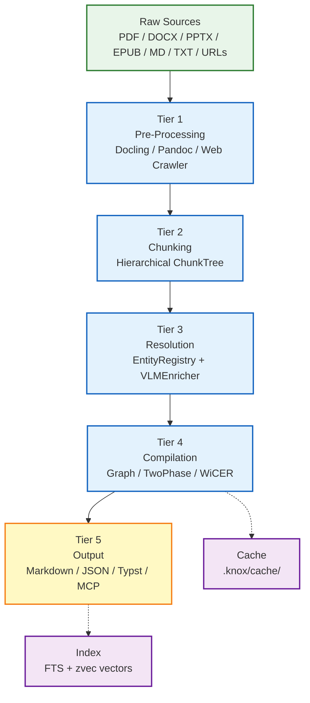

# KNOX Architecture

## Design Philosophy

KNOX decouples **parsing** from **compilation** and adds layers that existing frameworks skip: structure-aware chunking, multi-turn resolution, and a self-correcting compilation loop (WiCER). The architecture is tiered so each layer is independently replaceable.

## 5-Tier Architecture



## Data Models

### `ParsedDocument`

The output of Tier 1 (pre-processing).

```python
@dataclass
class ParsedDocument:
    source_file: Path
    elements: list[DocumentElement]
    title: str = ""
    author: str = ""
    language: str = "en"
    page_count: int = 0
    metadata: dict[str, Any] = field(default_factory=dict)
```

### `DocumentElement`

```python
class ElementType(StrEnum):
    TEXT = "text"
    HEADING = "heading"
    TABLE = "table"
    IMAGE = "image"
    FORMULA = "formula"
    CODE = "code"
    LIST_ITEM = "list_item"
    METADATA = "metadata"

@dataclass
class DocumentElement:
    type: ElementType
    content: str | list[list[str]] | bytes
    page: int | None = None
    reading_order: int | None = None
    heading_level: int | None = None
    metadata: dict[str, Any] = field(default_factory=dict)
    source_file: Path | None = None
```

### `Chunk` (leaf content)

```python
@dataclass
class Chunk:
    id: str
    text: str
    element_types: list[ElementType]
    source_elements: list[int]
    source_file: Path | None = None
    heading_context: str = ""
    token_count: int = 0
    reading_order: tuple[int, int] | None = None
    metadata: dict[str, Any] = field(default_factory=dict)
```

### `ChunkNode` / `ChunkTree` (hierarchical)

```python
@dataclass
class ChunkNode:
    id: str
    parent_id: str | None = None
    children_ids: list[str] = field(default_factory=list)
    depth: int = 0
    heading_chain: tuple[str, ...] = field(default_factory=tuple)
    chunk: Chunk | None = None          # leaf prose
    structured: StructuredData | None = None  # leaf table/equation/figure
    summary: str = ""                   # internal node summary
    token_count: int = 0

@dataclass
class ChunkTree:
    root_id: str
    nodes: dict[str, ChunkNode]
    source_file: Path | None = None
    strategy: ChunkStrategy = SINGLE_PASS
```

### `StructuredData` types

```python
@dataclass
class StructuredTable:
    columns: list[str]
    rows: list[dict[str, str]]
    caption: str = ""

@dataclass
class StructuredEquation:
    latex: str
    variables: list[EquationVariable] = field(default_factory=list)
    caption: str = ""

@dataclass
class StructuredFigure:
    caption: str
    alt_text: str = ""
    image_ref: str = ""
    description: str = ""
```

### `ResolvedChunk`

```python
@dataclass
class ResolvedChunk:
    chunk: Chunk
    entities: list[dict[str, Any]]       # resolved terms, abbreviations, etc.
    relations: list[dict[str, Any]]      # typed, confidence-scored edges
    resolved_references: list[str]
    metadata: dict[str, Any]
```

### `CompiledWiki`

```python
@dataclass
class CompiledWiki:
    nodes: list[WikiNode]
    edges: list[dict[str, Any]]    # typed graph edges (entity_reference, uses, …)
    toc: list[dict[str, Any]]      # table of contents
    quality_score: float           # WiCER evaluation metric
    iteration: int                 # WiCER loop count
    metadata: dict[str, Any]       # source_count, kinds, memory, …
```

## Core Principles (Expanded)

### 1. Parser-Agnostic

No parser is baked into KNOX's core. The `BaseParser` interface accepts raw documents and produces `ParsedDocument`. The `ParserRouter` selects by file extension and user preference. If a new parser emerges (`docu-sonic-9000`), add a module implementing `BaseParser()` — no other tier changes.

### 2. Structure-Preserving

Flattening a 50-row comparison table to markdown destroys queryability. KNOX stores tables as structured JSON (`list[list[str]]` with cell type annotations). Figures retain captions, bounding boxes, and extracted PNGs. Equations keep LaTeX source and image fallback.

### 3. Model-Aware

litellm provides provider abstraction, but KNOX goes further:

- Auto-detect context window from model metadata
- Reserve budget for system prompts (20%)
- Cheap local model for pre-processing (chunking heuristics)
- Expensive/remote model only for WiCER compilation
- Fallback chain: local → remote → error

### 4. Agent-Native

Three interfaces, same core:

- **CLI:** `knox compile sources/ --output wiki/`
- **Python SDK:** `pipeline.compile(sources=[Path("paper.pdf")])`
- **MCP Server:** `wiki_parse`, `wiki_compile`, `wiki_capture`, `wiki_learn` tools for Hermes/Claude Code/Codex

No GUI. No web server required. Headless cron-friendly.

### 5. Resolution-Ready

Default: one-shot ingestion (fast). Opt-in per document: multi-turn resolution (accurate). Resolvers are pluggable via MCP or CLI tools:

- Abbreviation expansion → `mcp_glossary_resolve`
- Cross-reference validation → `mcp_doi_lookup`
- Term disambiguation → `mcp_wikipedia_disambiguate`

### 6. Multimodal

Vision-capable LLMs analyze extracted figures during compilation. The `VLMEnricher` sends figure images + surrounding text + figure caption to a vision model. Output: searchable caption + classification ("architecture diagram", "performance graph", "workflow"). Figures become first-class wiki nodes. Enable with `--vlm-model` or `KNOX_VLM_MODEL`.

### 7. Iterative Compilation (WiCER)

Inspired by [arXiv:2605.07068v1](https://arxiv.org/pdf/2605.07068v1). Blind compilation over-compresses 2–3× beyond targets. WiCER recovers 80% of lost quality in 1–2 iterations via probe Q&A and targeted diagnosis. KNOX's `WikiCompiler` implements the CEGAR-style loop: compile → evaluate → diagnose → refine.

### 8. Hierarchical Chunk Tree

Structure-aware first: tables/figures/equations never split. Heading hierarchy
builds a `ChunkTree` with parent/child `ChunkNode` relationships — not a flat
list. Internal nodes carry LLM-generated summaries; leaf nodes carry prose
chunks or typed structured data (StructuredTable, StructuredEquation,
StructuredFigure). Adaptive strategy selects tree depth based on
(doc_size, context_window) ratio: single_pass, two_level, or multi_resolution.
This preserves queryability of structured data while enabling hierarchical
zoom for retrieval.

## Integration Points

### Hermes Agent

KNOX provides an MCP server (`src/knox/mcp/server.py`) exposing `wiki_parse`, `wiki_compile`, `wiki_capture`, and `wiki_learn` tools. Hermes skills can call these tools directly. The CLI remains the source of truth — the MCP layer is a thin wrapper.

### Open-WebUI

No custom GUI. KNOX exposes a queryable JSON graph / SQLite database. Open-WebUI connects via API. This follows the user's explicit requirement to minimize UI overhead.

### Hybrid RAG

`knox query` fuses multiple signals when an index has been built with `knox compile --index`:

- **FTS5** over compiled wiki pages
- **zvec vector search** over chunk embeddings
- **Token overlap** fallback
- **BM25** over raw-source files for hybrid scope

Results are combined with reciprocal rank fusion (RRF) so that each signal can rescue results the others miss. A sidecar zvec index is stored in `.knox/vectors/`; an FTS index is stored in `.knox/search.db`.

The `query` command supports a `--search-mode` (or `--scope`) option:

- `wiki` — Search only compiled wiki pages (FTS + vector + token).
- `raw` — Search only raw source files using BM25.
- `hybrid` — Combine wiki and raw results via RRF (default).
- `graph` — Hybrid search plus graph-traversal expansion, which follows typed relations (e.g., `depends_on`, `related_to`) to surface connected nodes with a decayed score.

Optional extras:

- **alibaba/zvec** — embedded vector database for similarity search
- **tobi/qmd** — local CLI search engine over the wiki corpus

## File Flow

```text
source.pdf
    → Tier 1: DoclingParser.parse() → ParsedDocument (structured JSON)
    → Tier 2: HierarchicalChunker.chunk() → ChunkTree (hierarchical)
    → Tier 3: EntityRegistry.scan_tree() + VLMEnricher.enrich()
    → Tier 4: TwoPhaseCompiler.compile(resolved, trees=all_trees) → compiled_wiki.json
    → Tier 5: MarkdownOutputWriter.write() → wiki/ (markdown files)
```

## References

- Karpathy's compiled LLM-wiki: <https://gist.github.com/karpathy/442a6bf555914893e9891c11519de94f>
- WiCER paper (arXiv:2605.07068v1): <https://arxiv.org/pdf/2605.07068v1>
- Docling: <https://github.com/docling-project/docling>
- Chonkie: <https://github.com/feyninc/chonkie>
- litellm: <https://github.com/BerriAI/litellm>

## See also

| Document | Description |
|---|---|
| [Output architecture](output.md) | Output writers, DocumentRenderer, flavor system |
| [Cache and state directory](cache.md) | `.knox/` layout, project-local vs global, cache lifecycle |
| [Decision log](decisions.md) | Architectural decisions and rationale |
| [Chunk tree design](chunk-tree.md) | Hierarchical chunk tree, fractal analysis, scaling matrix |
