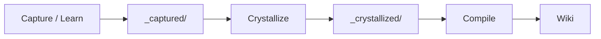

# Crystallize

Captured notes and conversation fragments accumulate in `sources/_captured/`. The `crystallize` command synthesizes these raw fragments into coherent wiki source pages that are then compiled into the knowledge base.

## Flow



## Commands

```bash
# Capture: LLM extracts decisions, discoveries, corrections from text
knox capture "We decided to use QKV projections with RoPE"

# Learn: store a verbatim fact
knox learn "The transformer uses d_model=512" --tag architecture

# Crystallize: synthesize all captures into wiki source pages
knox crystallize
```

## How it works

1. `crystallize` reads all `.md` files from `sources/_captured/`.
2. Captures are grouped by their first tag.
3. Each group is synthesized into a markdown source file via LLM (or a deterministic fallback if no LLM is available).
4. Output is written to `sources/_crystallized/` with frontmatter tracking the source captures.
5. A subsequent `knox compile` integrates the crystallized pages into the wiki.

## Output format

Each crystallized page includes:

```yaml
---
type: crystallized
title: "Attention Mechanisms"
synthesized_from:
  - capture-20260613T120000Z-00-attention-decision.md
  - learn-20260613T130000Z-attention-fact.md
tags:
  - attention
  - architecture
---
```

## See also

- [CLI Guide](../guides/cli.md) — capture, learn, crystallize commands
- [Wiki Structure](../guides/wiki-structure.md) — output directory layout
