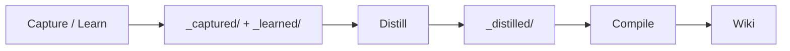

# Distill

Captured notes and conversation fragments accumulate in `sources/_captured/` and `sources/_learned/`. The `distill` command synthesizes these raw fragments into coherent wiki source pages that are then compiled into the knowledge base.

## Flow



`kompend compile --distill` runs the distill step immediately before the
pipeline, so the corpus can be refined and compiled in one command.

## Commands

```bash
# Capture: LLM extracts decisions, discoveries, corrections from text
kompend capture "We decided to use QKV projections with RoPE"

# Learn: store a verbatim fact
kompend learn "The transformer uses d_model=512" --tag architecture

# Distill: synthesize all captures into wiki source pages
kompend distill

# Or distill and compile in one run
kompend compile --distill
```

## How it works

1. `distill` reads the top-level `.md` files from `sources/_captured/` and `sources/_learned/`.
2. Captures are grouped by their first tag.
3. Each group is synthesized into a markdown source file via LLM (or a deterministic fallback if no LLM is available).
4. Output is written to `sources/_distilled/` with frontmatter tracking the source captures; re-runs update the existing page for a group in place.
5. The merged notes are archived to `sources/_archive/<kind>/` (unless `--no-archive`).
6. A subsequent `kompend compile` integrates the distilled pages into the wiki. `sources/_archive/` is never compiled or returned by query.

## Output format

Each distilled page includes:

```yaml
---
type: distilled
title: "Attention Mechanisms"
synthesized_from:
  - capture-20260613T120000Z-00-attention-decision.md
  - learn-20260613T130000Z-attention-fact.md
tags:
  - attention
  - architecture
---
```

## See also

- [CLI Guide](../guides/cli.md) — capture, learn, distill commands
- [Wiki Structure](../guides/wiki-structure.md) — output directory layout
