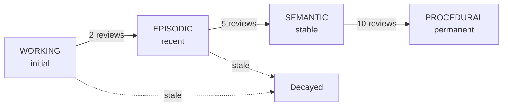

# Memory Lifecycle

KNOX tracks every wiki page through a four-tier memory lifecycle inspired by cognitive science models. Pages gain confidence over time, promote through consolidation tiers, and decay if not recompiled.

## Tiers



| Tier | Meaning | Promotion threshold |
|------|---------|-------------------|
| `WORKING` | Just created, untested | 2 compile reviews |
| `EPISODIC` | Seen recently, not yet stable | 5 compile reviews |
| `SEMANTIC` | Stable, well-supported | 10 compile reviews |
| `PROCEDURAL` | Permanent, deeply integrated | — |

## Confidence evolution

Each page starts at confidence 0.5 and asymptotically approaches 1.0:

```
confidence(n+1) = (confidence(n) + 1) / 2
```

## Retention decay

If a page is not recompiled, its retention decays exponentially:

```
retention = confidence * exp(-days_since_review / half_life)
```

Pages whose retention falls below `--memory-decay-threshold` (default 0.3) are flagged as stale by the `stale-page` lint rule.

## Supersession

When a new compile produces a page with the same title but a different node ID (e.g., content was restructured), the old page is marked `superseded_by` the new one. Superseded pages are excluded from stale checks and can be cleaned up.

## Configuration

```bash
knox compile *.pdf --memory                   # enable (default)
knox compile *.pdf --no-memory                # disable
knox compile *.pdf --memory-half-life-days 90 # decay speed
knox compile *.pdf --memory-decay-threshold 0.3
```

State is persisted at `base_dir/.knox/memory.json`.

## See also

- [Compilation Guide](../guides/compilation.md) — memory section with CLI flags
- [Trust & Memory](../guides/trust.md) — provenance and lifecycle
- [Linting](../guides/lint.md) — stale-page rule
