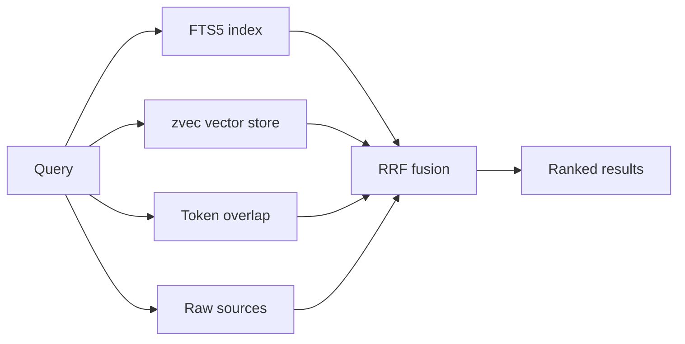
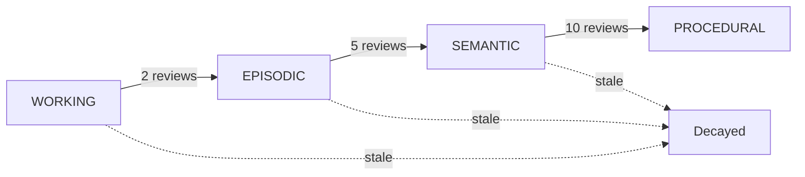
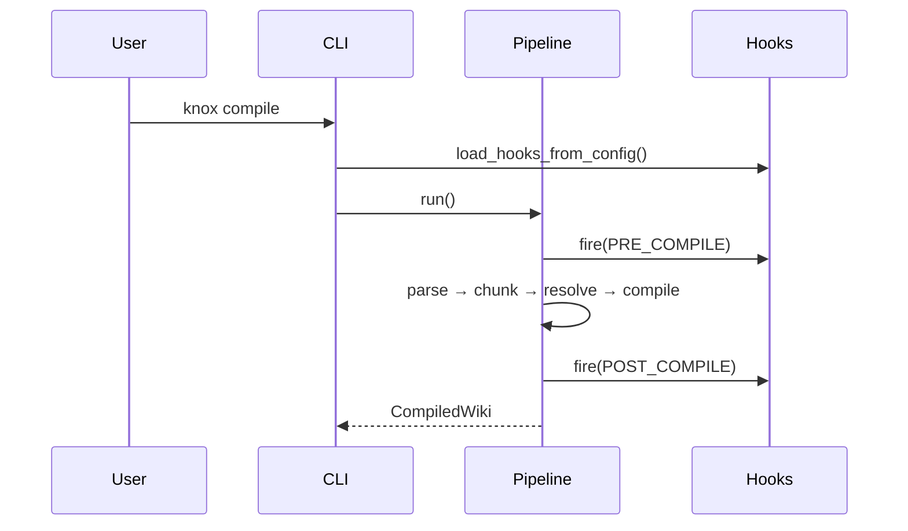

# Compilation Guide

KNOX compiles documents into a knowledge wiki through a five-tier pipeline.
This guide explains incremental compilation, compiler backends, prompt
budgeting, and per-source state.

## Pipeline tiers

| Tier | Name | What runs | Cost | Default |
|------|------|-----------|------|---------|
| 0 | Index | Parse + persist state | Free | ✅ |
| 1 | Chunk | Index + chunk documents | Free | ✅ |
| 2 | Resolve | Chunks → entities / references | Free | ✅ |
| 3 | Compile | Resolve → wiki pages | ~$0.05/doc | ✅ |
| 4 | Output | Write wiki to disk | Free | ✅ |

## Incremental compilation

Use `--start-at-tier` to skip tiers whose cached output is still valid. The pipeline validates that previous tiers ran before continuing.

```bash
knox compile *.pdf                                # full pipeline (T0→T4)
knox compile *.pdf --start-at-tier resolve        # skip re-parse+chunk, T2→T4
knox compile *.pdf --start-at-tier output         # re-render existing wiki, T4 only
knox compile *.pdf --force                        # invalidate all caches, full re-run
```

| Flag | Effect |
|------|--------|
| `--start-at-tier index` (default) | Run T0→T4 |
| `--start-at-tier chunk` | Skip T0 (uses cached parse output) |
| `--start-at-tier resolve` | Skip T0+T1 (uses cached chunks) |
| `--start-at-tier compile` | Skip T0–T2 (uses cached resolved graph) |
| `--start-at-tier output` | Re-render from cached CompiledWiki only |
| `--force` | Ignore all caches; full re-run |

### Ingest (T0+T1 only)

`knox ingest` downloads URLs and parses every source into structured
JSON — no chunking, no LLM. Use it to pre-stage large corpora cheaply
before an LLM compile:

```bash
knox ingest *.pdf              # download + parse only (no LLM)
knox compile --start-at-tier chunk   # later: T2→T5 using parsed sources
```

Parsed documents are cached in `.knox/cache/` using the same key format
as the pipeline, so compile picks them up transparently.

## WiCER compiler (config: `compile.compiler = wicer`)

The **non-default** `TwoPhaseCompiler` runs a concept-extraction pipeline:

1. **Extraction pass** — one LLM call per source, returns structured JSON
   (`{summary, entities, concepts, tags}`).
2. **Generation pass** — concepts from all sources are merged by name and
   one page is generated per unique concept. Cross-source edges are added
   for shared entities.

```bash
knox compile *.pdf --set compile.compiler=wicer
```

To use the **default** graph compiler explicitly:

```bash
knox compile *.pdf --set compile.compiler=graph
```

## Vision enrichment (VLM)

When a vision-capable model is configured, KNOX can caption extracted images and figures during Tier 2 resolution:

```bash
knox compile *.pdf --vlm-model openai/gpt-4o
# or via environment variable
export KNOX_VLM_MODEL=ollama/llava
knox compile *.pdf
```

The VLM receives the extracted image plus surrounding context and produces a caption that is carried into the compiled wiki.

## Typed knowledge-graph relations

By default, KNOX links pages only by shared entity mentions (`entity_reference`). With relation extraction enabled, the resolver asks the LLM to identify typed relations between entities (e.g., `uses`, `depends_on`, `contradicts`, `caused`, `fixed`, `supersedes`) and attaches a confidence score:

```bash
knox compile *.pdf --resolve-relations --relation-confidence-threshold 0.7
# or via config
export KNOX_RESOLVE_RELATIONS=true
```

Typed relations are emitted as graph edges and rendered in the `Related` section of each wiki page (`[[Page]] (uses) — confidence 0.85`).

## Hybrid search

The `knox query` command fuses four result channels via reciprocal rank fusion (RRF, k=60):



The vector store is built at compile time by default (indexing is on; pass `--no-index` to skip) and re-opened at query time using the persisted embedding model. If the vector store is absent, the retriever falls back to token overlap only.

## Page kinds

The default `graph` compiler infers a built-in page kind for each wiki page:

| Kind | Heuristic |
|------|-----------|
| `overview` | Root or "Overview" page |
| `comparison` | Comparison/contrast-style heading context |
| `entity` | Page title matches a resolved entity name |
| `concept` | Default for everything else |

The kind is written to the page frontmatter (`kind: entity`) and included in the compiled wiki metadata distribution.

## Memory lifecycle

KNOX tracks every wiki page through a four-tier memory lifecycle with confidence scoring, supersession detection, and retention decay:



| Concept | Description |
|---------|-------------|
| **Confidence** | Starts at 0.5, asymptotically approaches 1.0 with each compile cycle |
| **Retention** | `confidence * exp(-days_since_review / half_life)` — pages decay if not recompiled |
| **Supersession** | If a new page has the same title but a different node ID, the old page is marked `superseded_by` |
| **Tier promotion** | WORKING→EPISODIC (2 reviews), EPISODIC→SEMANTIC (5), SEMANTIC→PROCEDURAL (10) |

```bash
knox compile *.pdf --memory              # enable (default)
knox compile *.pdf --no-memory           # disable
knox compile *.pdf --set compile.memory_half_life_days=180
knox compile *.pdf --set compile.memory_decay_threshold=0.2
```

Memory state is persisted at `base_dir/.knox/memory.json`. Stale and superseded pages surface as lint failures in the `stale-page` rule.

## Event hooks

KNOX fires lifecycle events that user callbacks can observe. Hooks are registered in `knox.toml` under `[hooks]` using a `module:attribute` syntax:

```toml
[hooks]
on_query = ["my_plugin:log_query"]
post_compile = ["my_plugin:reindex", "my_plugin:notify"]
```

| Event | When | Context keys |
|-------|------|-------------|
| `PRE_COMPILE` | Start of `pipeline.run()` | `source_dir`, `output_dir`, `mode` |
| `POST_COMPILE` | After compile + memory update | `wiki`, `output_dir`, `node_count` |
| `ON_CAPTURE` | After `capture()` / `learn()` writes files | `paths`, `kind` |
| `ON_QUERY` | After search results in `query` command | `query`, `results` |
| `ON_LINT` | After lint report is generated | `report` |



Hook callbacks receive a `HookContext` and exceptions are isolated — a failing hook never breaks the pipeline.

## Prompt budget

Each concept page in phase 2 sees at most `compile.budget.gen_output_max`
characters of source content. When a concept draws from many sources, the
content is **fair-share truncated** — each source gets an equal slice, not
first-N-chunks. Excess truncation is logged. Tune it in config:

```bash
knox config set compile.budget.gen_output_max 100000
knox compile *.pdf --set compile.budget.gen_output_max=100000
```

## Per-source state

KNOX persists a tier checkpoint for every source file:

```json
{
  "entries": {
    "paper": {
      "stem": "paper",
      "source_path": "sources/paper.pdf",
      "content_hash": "a1b2c3...",
      "current_tier": 3,
      "last_compile": "2026-06-08T12:34:56+00:00",
      "search_hits": 0
    }
  }
}
```

The file lives at `.knox/compile_state.json` (at the project root). Delete
it (or pass `--force`) to force a full recompile.

## Tier listing

```bash
knox compile *.pdf --list-tiers
```

Prints a JSON list of every tier with the count of sources that have
reached it. Useful in CI for "how complete is this wiki?" checks.

## FAQ

**Q: How do I re-compile a single source?**
A: `knox compile sources/foo.pdf --force`

**Q: Why is my source at tier 0 after a failed compile?**
A: The tier is updated only after the chunk succeeds. Re-run `knox compile`.

**Q: How does merge work on re-ingest?**
A: In two-phase mode, entities/concepts from the new source are merged
with existing pages — old content is preserved, new provenance is added.

**Q: Can I run just the LLM stages?**
A: Yes: `knox compile *.pdf --start-at-tier resolve` skips re-parsing and chunking.

**Q: How do I get a JSON status report?**
A: `knox compile *.pdf --list-tiers` outputs JSON.

## Q: Ingest hangs or crashes on large scanned PDFs

Large scanned PDFs (50+ pages) can exhaust memory during OCR
processing — Docling's RapidOCR backend loads ONNX models that
allocate gigabytes of RAM for batch inference. Symptoms include
unresponsive process, `std::bad_alloc` errors, or extremely slow
ingest.

Mitigations (in order of effectiveness):

1. **Chunk by page range** — process the PDF in segments of 20–30
   pages using `page_range`, then merge results. This bounds peak
   memory per conversion call.

2. **Reduce batch sizes** — Docling's pipeline options accept
   `ocr_batch_size`, `layout_batch_size`, and `table_batch_size`.
   Lower values (e.g. 2) trade throughput for memory.

3. **Disable enrichment** — set `generate_parsed_pages=False`,
   `do_formula_enrichment=False`, `do_code_enrichment=False` in the
   Docling pipeline options to skip optional heavy passes.

4. **Subprocess isolation** — run each large PDF in a separate OS
   process so the kernel reclaims all memory on exit. This is the
   most reliable fix for ONNX OOM.

5. **Lighter backend** — use `PyPdfiumDocumentBackend` instead of the
   default Docling backend when full OCR is not needed.

For configuration details and implementation tracking, see beads
issue `knox-oc2n`.
