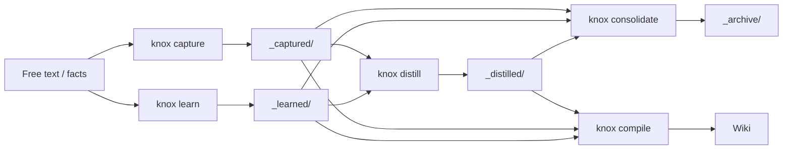

# Input Pipeline: capture, learn, distill, consolidate

KNOX's **input pipeline** turns free-form notes, facts, and conversation
snippets into *source material* that the next `knox compile` folds into the
wiki. Four commands work together:

| Command | Writes to | What it does | LLM? |
|---|---|---|---|
| `knox capture "<text>"` | `sources/_captured/` | LLM-extracts **knowledge items** (decisions, discoveries, corrections, references, notes) from free text — one file per item | ✅ |
| `knox learn "<fact>"` | `sources/_learned/` | Stores a fact **verbatim**, no LLM — one file | ❌ |
| `knox distill` | `sources/_distilled/` | Groups captured/learned notes by tag and LLM-merges each group into one coherent page | ✅ |
| `knox consolidate` | `sources/_archive/<kind>/` | Finds near-duplicate notes and archives the redundant ones | ⚙️ (embeddings optional) |

All four operate **only** on the tool-managed input zones under `sources/`.
Real source documents (PDFs, DOCX, standards) are never touched.

## Where files land

```text
sources/
├── _captured/   ← capture output (LLM-extracted items)
├── _learned/    ← learn output (verbatim facts)
├── _distilled/  ← distill output (synthesized pages)
└── _archive/    ← notes archived by distill/consolidate
    ├── capture/
    ├── learn/
    └── distilled/
```

Everything under these zones is a **source**: the next `knox compile` parses,
chunks, and resolves it like any other document. `knox organize` never
flattens or relocates them.

## capture vs learn

- **`capture`** runs an LLM extraction over the text. It is for substantive
  input — a discussion, a decision log, a paragraph worth mining. The
  CaptureAgent splits it into one file per knowledge item, each with a
  `type`, `title`, `tags`, and `source: capture` frontmatter.
- **`learn`** stores the text exactly as given, with no LLM call. Use it for
  short facts you already know you want recorded.

Both accept `--tag` (repeatable) and `--attr KEY=VALUE` (repeatable) — tags
for hierarchy, attributes for filterable key=value facts. Both are written to
the file's frontmatter and flow into the parse cache and compile pipeline.

### Nonsense-input refusal

`capture` refuses input that contains nothing extractable. The CaptureAgent
is instructed to set `refused: true` (with a short reason) for gibberish,
pure pleasantries, or single trivial fragments — it never invents items or
echoes the input back as a "note". When the agent refuses (or returns no
items), `capture` writes nothing and warns:

```text
Nothing captured — the input contained no extractable knowledge items.
```

Only a truly empty input is rejected up front; the agent is the judge of
"nonsense".

## distill

`distill` reads all notes from `_captured/` and `_learned/`, groups them by
their first tag (untagged → `general`), and LLM-merges each group into a
single page in `_distilled/` (deterministic concatenation fallback when no
LLM is available).

Two behaviors keep repeated runs from piling up duplicates:

- **Update in place** — a group's page is *updated* (same file) on re-run
  instead of accumulating a new timestamped file per run.
- **Archive originals** — by default the distilled source notes are moved to
  `sources/_archive/<kind>/` after a successful write. Pass `--no-archive`
  to keep them in place.

```bash
knox distill            # synthesize + archive originals
knox distill --no-archive
```

## consolidate

`consolidate` finds and archives **redundant** notes across `_captured/`,
`_learned/`, and `_distilled/`. Near-duplicates are detected with rapidfuzz
token similarity, plus an embedding tier when an embedding model is
configured. For each duplicate group the newest or longest note is kept; the
rest are archived to `sources/_archive/<kind>/`.

```bash
knox consolidate --dry-run   # preview what would be archived
knox consolidate             # archive duplicates (default)
knox consolidate --no-archive  # report only, keep everything
```

## The full flow



Run `knox compile` after `distill`/`consolidate` to fold the results into
the compiled wiki.
