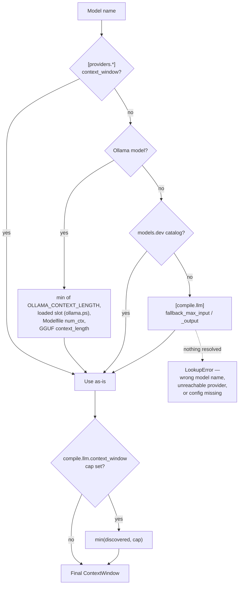
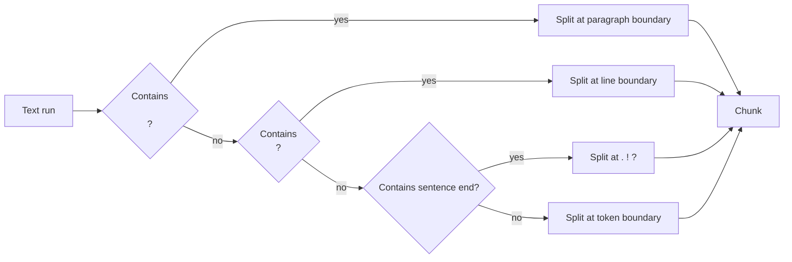
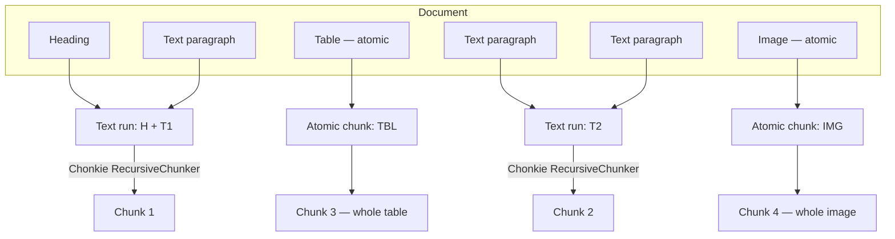
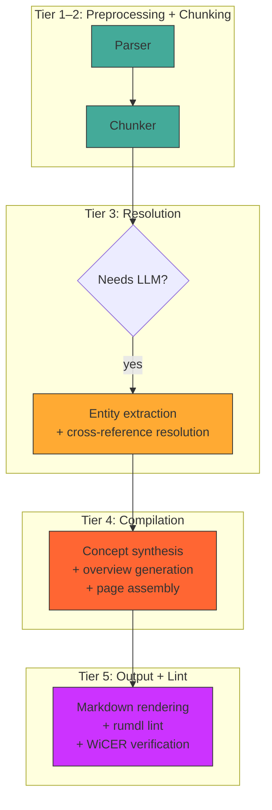

# Model Context Adaptation

kompend is designed to work with any LLM — from a 4K-token local model running
on a laptop to a 1M-token frontier model behind an API. This guide explains
how kompend detects model capabilities, adapts its chunking and processing
strategy accordingly, and what tradeoffs you should expect when choosing
between small/local and large/remote models.

> **Honest summary:** kompend enables any model to participate in the pipeline,
> but it does **not** equalize quality. A 7B local model will produce
> noticeably lower-quality wiki pages than a frontier model. The adaptive
> machinery ensures the *input* always fits — the *output quality* is yours
> to control through model selection.

## How kompend Discovers the Context Window

At startup, [`discover_context_window()`](https://github.com/jr2804/kompend/src/branch/main/src/kompend/llm/context_window.py)
in `kompend.llm.context_window` resolves the model's real input and output token
capacity through the chain below — the first tier that answers wins:



| Tier | Source | Typical models |
|------|--------|----------------|
| 1 — User config | `context_window` in `[providers.<name>]`, or finer-grained in `[providers.<name>.models."<model>"]` | Self-hosted OpenAI-compatible endpoints (llama.cpp, vLLM, TGI); any provider you want to pin explicitly |
| 2 — Ollama | most restrictive of `OLLAMA_CONTEXT_LENGTH`, the context the server actually loaded the model with (`ollama.ps()`), Modelfile `parameters.num_ctx`, and GGUF metadata (`ollama.show()`) | Local Ollama models |
| 3 — models.dev | [models.dev](https://models.dev) catalog via `kompend.llm.models.resolve_model_limits()` | Hosted models and custom-provider mirrors present in the catalog |
| 4 — Fallback | `[compile.llm] fallback_max_input` / `fallback_max_output` | Models nothing else knows about |
| — | none of the above | raises `LookupError` — an unresolved window usually means a wrong model name or an unreachable provider |

Tiers 1–2 are used **as-is** — never clamped (except by the explicit cap).
When several Ollama values exist the most restrictive wins: if GGUF metadata
claims 128K but the server loaded the model with 65536 tokens, kompend sizes
against 65536.

You can enforce a hard ceiling with `compile.llm.context_window`:

```toml
[compile.llm]
default_model = "ollama/llama3.1"
context_window = 32768   # never exceed 32K even if the model reports more
```

`context_window_cap` was renamed to `context_window` in both `[compile.llm]`
and `[providers.<name>]`; a config still setting the old name keeps working
(the value is migrated, with a deprecation warning) — but please update it.

## Adaptive Chunking

### The Sizing Formula

Once the context window is known, the chunker
([`kompend.chunking.hierarchical.HierarchicalChunker`](https://github.com/jr2804/kompend/src/branch/main/src/kompend/chunking/hierarchical.py))
computes the target chunk size:

```text
raw        = max(0, max_input - reserve_tokens)
effective  = max(chunk_size_min, min(raw, chunk_size_max))
```

| Parameter | Default | Env var | Meaning |
|-----------|---------|---------|---------|
| `reserve_tokens` | `8192` | — | Absolute headroom for system prompt + LLM output budget |
| `chunk_size_min` | `2048` tokens | `KOMP_BUDGET_CHUNK_SIZE_MIN` | Safety floor — never produce smaller chunks |
| `chunk_size_max` | `131072` tokens | `KOMP_BUDGET_CHUNK_SIZE_MAX` | Safety ceiling — never produce larger chunks |

> **Why absolute, not percentage?** A 20% ratio reserves 200K tokens on a
> 1M-context model where the real overhead (system prompt + output budget)
> is bounded at a few thousand tokens. Absolute reserves scale correctly:
> the chunker recovers ~25K extra tokens at 128K and ~190K at 1M without
> sacrificing safety on small models, where the ``chunk_size_min`` floor
> still applies.

### Headroom margin

Every stage that sizes a request against the context window also holds back a
safety margin, defined once as ``context_safety_tokens()`` in
`kompend.compilation._two_phase_core`:

```text
margin = max(512, 8% of the context window)
```

Two reasons it is not simply "whatever the measured overhead leaves free":

1. A server's **effective** usable context is smaller than the nominal window
   (KV-cache slotting, prompt-cache rollover).
2. ``default_chars_per_token`` (3.85) is a heuristic — it **undercounts**
   token-dense content (formulas, tables, identifiers), so a nominally
   exact-fit request can still overflow. Observed on a formula-heavy standard:
   `request (65762 tokens) exceeds the available context size (65536 tokens)`.

The margin never crops content — the content budget shrinks, so the work
splits across more batches or segments. Both extraction batching and agentic
generation segments use it, from the single shared definition.

### Concrete Sizing by Model Class

| Model context | Available (− reserve) | Effective after clamp | Clamped? |
|---------------|-----------------------|-----------------------|----------|
| 4K (e.g. Phi-3-mini) | −4 096 | **2 048** | Yes — floored to min |
| 8K (e.g. Llama 3.1 8B) | 0 | **2 048** | Yes — floored to min |
| 32K (e.g. Mistral 7B) | 23 808 | **23 808** | No |
| 128K (e.g. GPT-4o) | 122 880 | **122 880** | No |
| 200K (e.g. Claude 3.5) | 196 608 | **131 072** | Yes — capped at max |
| 1M (e.g. Gemini 1.5) | 991 808 | **131 072** | Yes — capped at max |

Without the clamp, a 1M-token model would produce 992K-token chunks —
far too large for retrieval quality. The `chunk_size_max` rail prevents this.

> **Configuring the rails:** Lower `chunk_size_max` for finer-grained
> retrieval chunks. Raise `chunk_size_min` to avoid tiny fragments from
> very small models. Both are in tokens, measured with the `cl100k_base`
> tokenizer.

### Splitting Strategy

kompend never blindly cuts text at a token boundary. The `HybridChunker` uses
a custom `RecursiveRules` stack that respects document structure:



**Atomic elements** — tables, images, formulas, and code blocks — are
**never split** regardless of size. Each gets its own dedicated chunk.
This preserves structural integrity for downstream processing.



## Small/Local vs Large/Remote: The Quality Tradeoff

kompend's adaptive sizing guarantees that **inputs always fit** the model's
context window. But input fitting is only half the story — the other half
is **output quality**, which is entirely model-dependent.

### What kompend Adapts Automatically

| Aspect | How kompend adapts |
|--------|-----------------|
| Chunk size | `context_window − reserve_tokens`, clamped to rails |
| Number of chunks | Inversely proportional to chunk size |
| Answer room | A quarter of the window (max 8 192 tokens), reserved by the planners |
| Retrieval system-prompt reserve | 4 096 tokens absolute |
| Retrieval response reserve | 4 096 tokens absolute |

### What kompend Does NOT Equalize

| Aspect | Small/local model | Large/remote model |
|--------|-------------------|--------------------|
| Extraction quality | More entity misses, noisier results | Fewer misses, cleaner entities |
| Concept synthesis | Shallower summaries, simpler prose | Richer synthesis, better cross-referencing |
| Verification accuracy | Lower precision/recall on WiCER checks | More reliable verification |
| Latency | Fast (local), but many more round-trips | Slper API, but fewer round-trips |
| Cost | Free (local) or low | Per-token API cost |
| Privacy | Fully local — data never leaves the machine | Data sent to provider API |
| Round-trips | Many (smaller chunks = more LLM calls) | Fewer (larger chunks = fewer calls) |

### Why More Chunks ≠ Better

With a small model (e.g. 8K context), a 50-page document might produce
15 chunks → 15 extraction calls → 15 synthesis calls. Each call has
independent error surface. A large model (128K+) might handle the same
document in 2 chunks → 2 calls, with the model seeing more context per
call for better cross-referencing.

The cost/quality curve is **not linear** — the jump from 8K to 32K is
more impactful than from 128K to 1M, because below ~16K the chunker is
forced to split semantic units that belong together.

## How Far the Answer May Go

kompend sends **no output ceiling**. There is no `max_tokens` in any request:
an answer is bounded by physics - the context window minus its prompt - so a
configured number could only make it shorter than the model allows, and a
number larger than the window fails the request outright
(`Model token limit (N) exceeded before any response was generated`, where N
is the ceiling kompend sent).

What the pipeline does instead is *plan* the request:

```text
answer_reserve = clamp(context_window / 4, 512, 8192)   # ContextWindow.answer_reserve
input_budget   = context_window - answer_reserve - measured_overhead
```

`answer_reserve` is what a planner leaves free for the answer when it decides
how much source text to put in one call (`ContextWindow.input_budget`). It is
an assumption, not a limit: a model whose prompt ended up smaller than planned
simply gets more room to answer, and the window is what stops it.

Consequences worth knowing:

- A stage that writes long pages works on a 32K window exactly as it does on a
  1M window: the segments get smaller, the calls get more numerous, no content
  is dropped.
- Nothing truncates an answer except the window itself. If a reply is cut off,
  the prompt was too big for the model - shrink the input (smaller
  `chunk_size_max`, fewer nodes per summarizer session), not the output.
- Two things still bound a run instead of a response: the per-request timeout
  (`compile.llm.timeout`) and the multi-turn request budgets of agentic
  sessions (`budget.summary_requests_per_node`, WiCER's wall clock).

## Structural Controls

Beyond token budgets, `BudgetConfig` provides content-quality controls:

| Field | Default | Env var | Purpose |
|-------|---------|---------|---------|
| `min_content_length` | `50` | `KOMP_BUDGET_MIN_CONTENT_LENGTH` | Warning threshold for body length (heading-only fragments are dropped, short pages are kept) |
| `min_concept_sources` | `2` | `KOMP_BUDGET_MIN_CONCEPT_SOURCES` | Min distinct sources for a cross-cutting concept page |
| `max_concept_pages` | `50` | `KOMP_BUDGET_MAX_CONCEPT_PAGES` | Warning threshold for generated concept pages (all candidates are compiled) |
| `concepts_per_batch` | `8` | `KOMP_BUDGET_CONCEPTS_PER_BATCH` | Concepts extracted per LLM batch |
| `verify_min_ngram` | `3` | — (config only) | Min n-gram overlap for verification |
| `wicer_max_iterations` | `0` | `KOMP_BUDGET_WICER_MAX_ITERATIONS` | Refinement rounds — `0` runs until the loop converges |
| `wicer_max_seconds` | `1800` | `KOMP_BUDGET_WICER_MAX_SECONDS` | Wall-clock budget of the refinement loop (`0` disables it) |

## No Silent Exclusions

A budget never decides what gets compiled. It only decides how many calls a
piece of work needs:

- **Content is windowed, never truncated.** Node summaries split long
  content into several calls (`summary_max_content_chars`), the agentic
  summarizer splits its payload into windows of `summary_window_chars`
  (one summarize call per window), reference sections are split per source
  window, and the write-page synthesis reads a source in windows of
  `capture_source_char_max` (the agent pages through it with the offset the
  reply names) — the tail always reaches the model, the cost is extra LLM
  calls.
- **Thresholds warn, they do not drop.** `min_content_length` and
  `max_concept_pages` log a warning when a page is short or a run produces
  many concept pages; the content is still compiled.
- **Only empty content is dropped.** A page without any body text has
  nothing to compile.
- **Timeouts and loops are the only stop reasons.** A provider timeout, a
  wall-clock budget, or a model that never stops calling tools ends the
  work — and what was already compiled is kept.

If a run reports a warning about a threshold, the fix is a bigger budget
or a faster model — never a smaller exclusion.

## Example Configurations

### Local-Only Setup (Ollama, 8K–32K)

```toml
[compile.llm]
default_model = "ollama/llama3.1"
# Ollama auto-detected via /api/show or OLLAMA_CONTEXT_LENGTH.
# For models without metadata, set explicitly:
# context_window = 32768

[compile.budget]
# Smaller chunks for finer retrieval granularity.
chunk_size_min = 2048
chunk_size_max = 24576      # 32K context − 8192 reserve_tokens
# Lower concept-page generation to reduce LLM calls.
max_concept_pages = 20
# Tighter output budgets — small models work better with focused prompts.
```

**When to use:** Privacy-sensitive documents, air-gapped environments,
cost-sensitive projects, rapid prototyping.

### Balanced Setup (32K–128K hosted)

```toml
[compile.llm]
default_model = "openai/gpt-4o"
# models.dev auto-detects 128K context.
fallback_chain = ["anthropic/claude-3.5-sonnet"]

[compile.budget]
# Defaults are well-tuned for mid-range models.
# chunk_size_min = 2048    # default
# chunk_size_max = 131072  # default
```

**When to use:** Production wikis, collaborative knowledge bases, best
quality-to-cost ratio.

### Enterprise Setup (128K–1M)

```toml
[compile.llm]
default_model = "gemini/gemini-1.5-pro"
# the catalog reports 1M; kompend clamps chunks to chunk_size_max=131072.
fallback_chain = ["anthropic/claude-3.5-sonnet", "openai/gpt-4o"]

[compile.budget]
# Larger chunks leverage the model's long-context reasoning.
chunk_size_max = 131072     # default — already optimal
# Richer concept pages for deep knowledge bases.
max_concept_pages = 100
```

**When to use:** Large document corpora (500+ pages), research compendia,
enterprise documentation projects where quality is the priority.

## Tier-Based Model Strategy

kompend's 5-tier pipeline has different model requirements per tier:



| Tier | LLM needed? | Model preference | Why |
|------|-------------|------------------|-----|
| 1 — Preprocessing | No | — | Pure parsing, no model involvement |
| 2 — Chunking | No | — | Token-based splitting, no model involvement |
| 3 — Resolution | Yes | **Capable model** | Entity extraction and cross-referencing require reasoning |
| 4 — Compilation | Yes | **Strongest model** | Concept synthesis and overview generation are quality-critical |
| 5 — Output + Lint | Yes (lint/WiCER) | **Capable model** | Verification and quality checks need judgment |

> **Practical tip:** The compilation tier (Tier 4) benefits most from model
> quality. If budget is limited, use a cheaper model for Tier 3 (resolution)
> and reserve the strongest model for Tier 4 (compilation) via the fallback
> chain.

## Configuring the Fallback Chain for Model Tiers

The fallback chain lets you define a quality cascade:

```bash
kompend compile sources/ \
  --llm-default-model anthropic/claude-3.5-sonnet \
  --llm-fallback-chain openai/gpt-4o \
  --llm-fallback-chain ollama/llama3.1
```

The primary model is tried first. If it fails with transient errors
(rate limits, timeouts), the chain advances. This gives you:

1. **Quality first** — the best model handles the majority of work.
2. **Resilience** — if the primary is unavailable, a cheaper model steps in.
3. **Privacy escape hatch** — a local Ollama model at the end of the chain
   ensures the pipeline can complete even without network access.

## Summary

| Concern | kompend handles it? | How |
|---------|------------------|-----|
| Input always fits context | Yes | Auto-detect + clamp + 8% safety margin (min 512 tokens) |
| Chunk boundaries are natural | Yes | Paragraph → line → sentence → token rules |
| Atomic elements preserved | Yes | Tables/images/formulas/code never split |
| Output quality | **No — model-dependent** | Choose models by tier importance |
| Privacy | **User's choice** | Local Ollama vs remote API |
| Cost optimization | **User's choice** | Fallback chain + budget config |

kompend ensures every model can *participate* in the pipeline. It does not
promise every model will produce the *same output*. The adaptive machinery
removes the mechanical barriers (context overflow, truncation, structural
breakage); the intellectual quality of the resulting wiki is bounded by
the model you select.
